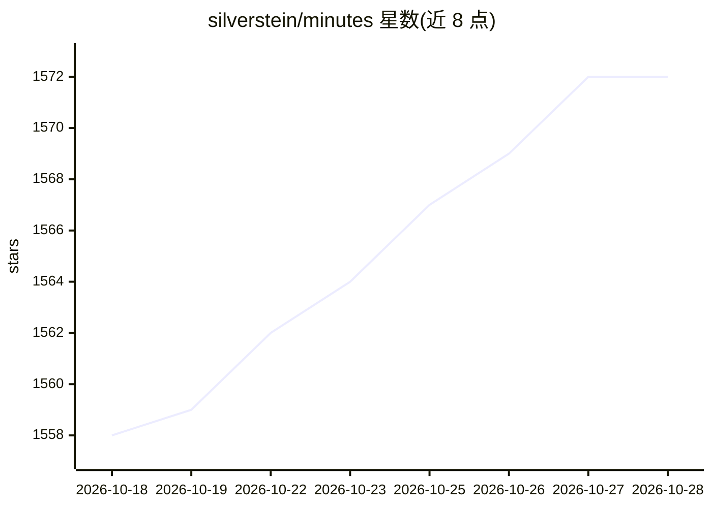

# silverstein/minutes

⭐ 1,572 · Rust · MIT · 推送 2026-10-27 · [GitHub](https://github.com/silverstein/minutes) · [官网](https://useminutes.app) · 个人维护

**本地优先的会议/语音录制转录应用，产出自有 Markdown 记录**

开源的本地优先对话记忆应用：在设备上录制并转录会议、通话、语音备忘与听写，输出为用户自有的 Markdown+YAML 文件（~/meetings/）。提供桌面应用、60 命令 CLI、34 工具 MCP 服务器、23 技能的 Claude Code 插件与 TypeScript SDK，供 Claude Code、Codex、Cursor 等 MCP 客户端检索会议历史。转录与说话人处理在本机运行，文本仅在用户授权时发送给云端助手。

## 筛选速览

| 维度 | 判定 | 备注 |
|---|---|---|
| AI 角色 | `ai-native` | 本体是模型或模型工具 |
| 许可风险 | `permissive` | MIT |
| 部署形态 | `library` | 以包/库形式分发 |
| 模型依赖 | — | README 未给出锁定关系 |
| 硬件要求 | — | 无带数字的原话,不猜 |
| 安装摩擦 | `low` | 无编译、无系统依赖或容器化 |
| 成熟度 | — | 结构信号不足 |

## 能力要点

- 设备端录制与转录，输出本地 Markdown+YAML frontmatter
- 五种交付面：桌面应用、CLI、MCP 服务器、Claude Code 插件、SDK
- 敏感会议默认受限保存，含同意提示与来源记录
- 支持 Teams/Zoom（macOS）可选自动通话录制

## 适用场景

- 把会议、通话和语音备忘转成我可拥有和检索的文字记录
- 让 Claude Code/Cursor 等 agent 查询我的会议历史
- 本地听写并整理进 Obsidian 等知识库

## 场景标签

`语音识别` `知识库管理` · 领域:知识与检索

## 证据(README 行号)

> L10: Minutes is a free, open-source conversation memory app for the AI you already use. Record and transcribe meetings, 
> L120: - Transcription and speaker processing run on-device. Audio stays on your machine.

## 星数曲线

2026-10-18 1,558 → 2026-10-28 1,572（+14）

---
*卡片 v1 · prompt 1.4 · 生成 2026-10-21 · 置信度 high · 依据 README sha `8acfaa4a95ab` · [字段定义](../../DATASET.md)*
