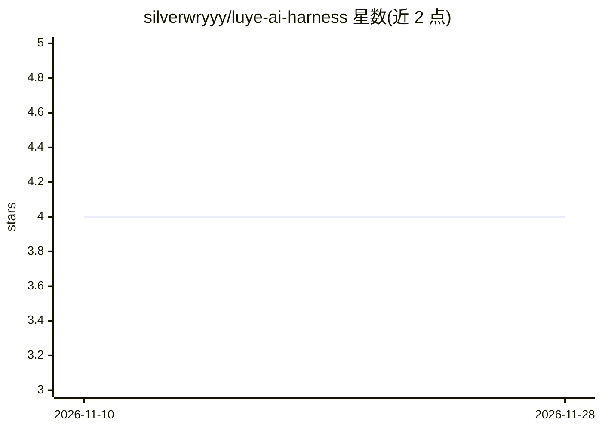

# silverwryyy/luye-ai-harness

⭐ 4 · Python · MIT · 推送 2026-11-13 · [GitHub](https://github.com/silverwryyy/luye-ai-harness) · 个人维护 · 中文 README

**本地优先的 Windows 桌面 AI 助手：常驻小窗、聊天、三层记忆**

以文件夹形式分发的 Windows 桌面 AI 助手，通过 .bat 脚本安装（自动装 Python、建虚拟环境、写 .env）。桌面常驻圆形小窗，支持聊天、读写本地文件、扫目录、联网搜索、跑命令、读写 Word 共 8 个工具调用；三层记忆（L1 核心锚点/L2 长期议题/L3 临时上下文）跨会话保留信息，另有空闲主动搭话、摸头互动与崩溃留日志机制。数据全部留在本机。非成品软件，需自填 DeepSeek API Key 才能使用。

## 筛选速览

| 维度 | 判定 | 备注 |
|---|---|---|
| AI 角色 | `ai-native` | 本体是模型或模型工具 |
| 许可风险 | `permissive` | MIT |
| 部署形态 | `library` | 以包/库形式分发 |
| 模型依赖 | locked-api |  |
| 硬件要求 | — | 无带数字的原话,不猜 |
| 安装摩擦 | `low` | 无编译、无系统依赖或容器化 |
| 成熟度 | — | 结构信号不足 |

## 能力要点

- 三层记忆机制：核心锚点每轮必带、长期议题命中带、临时上下文折叠
- 8 个可调用工具：文件读写、扫目录、联网搜索、跑命令、Word 读写等
- 常驻桌面小窗，鼠标事件穿透、睡眠模式与摸头互动
- 一键安装脚本含 Python 安装兜底与依赖自检

## 适用场景

- 在 Windows 桌面上通过小窗与 AI 助手聊天并让它操作本地文件
- 需要跨会话记住长期议题的日常助理
- 数据敏感、要求对话与记忆全部留在本机的场景

## 场景标签

`AI 助手` `聊天机器人` · 领域:对话与助手

## 证据(README 行号)

> L3: 一个住在 Windows 桌面上的 AI 助手：小窗常驻、能聊天、会主动搭话，崩了还会自己留证据。
> L15: - **8 个工具**：读写本地文件、扫目录、联网搜索、跑命令、读写 Word、调技能，聊天里直接使唤它
> L16: - **三层记忆**：L1 核心锚点每轮必带、L2 长期议题命中才带、L3 临时上下文超限才折叠；关了再开还记得你

## 星数曲线

2026-11-10 4 → 2026-11-28 4（+0）

---
*卡片 v1 · prompt 1.4 · 生成 2026-11-21 · 置信度 high · 依据 README sha `68dc902e80e9` · [字段定义](../../DATASET.md)*
