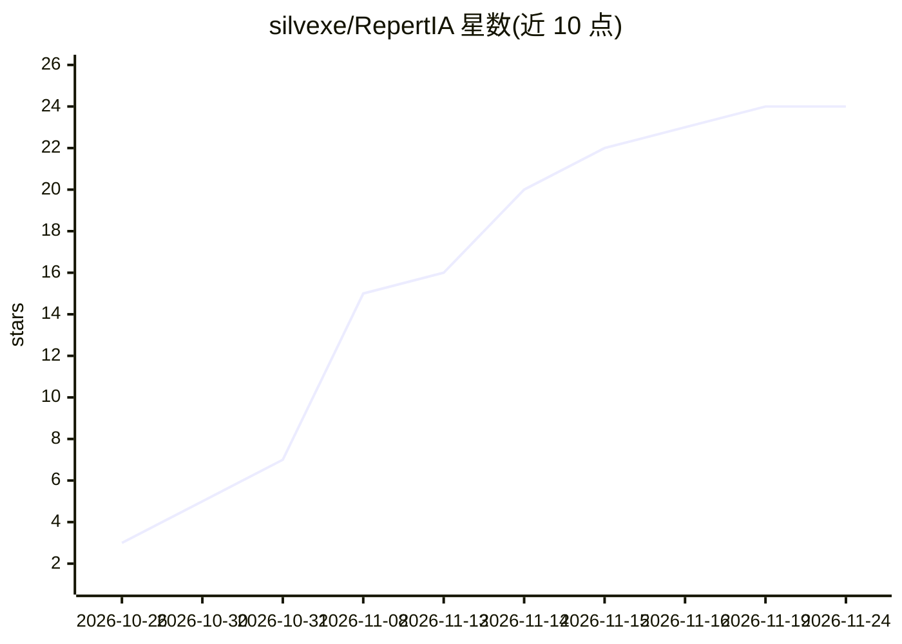

# silvexe/RepertIA

⭐ 24 · Python · AGPL-3.0 · 推送 2026-11-21 · [GitHub](https://github.com/silvexe/RepertIA) · [官网](https://github.com/silvexe/RepertIA/releases/latest) · 个人维护

**取证分析工具：磁盘镜像/手机提取/无人机日志，AI 助手可选**

面向取证分析人员的本地工具：读取 E01/raw/dmg 磁盘镜像、iPhone/Android 全文件系统提取、逻辑证据源、Windows RAM 内存转储与无人机飞行日志，集成 Sleuth Kit、plaso、iLEAPP/ALEAPP、PhotoRec 等工具，生成带时间线、搜索、聊天视图与哈希链审计日志的案件，输出 Markdown/Word/PDF 报告。本地语言模型为可选组件（LM Studio、llama-server 或 Ollama），不带模型时全部功能照常运行；无云服务与遥测，界面仅监听 127.0.0.1。界面语言为英语或意大利语，Linux 版为实验性。

## 筛选速览

| 维度 | 判定 | 备注 |
|---|---|---|
| AI 角色 | `ai-enhanced` | 去掉 AI 部分产品仍成立 |
| 许可风险 | `viral` | AGPL-3.0 |
| 部署形态 | `desktop` | 安装包/桌面程序 |
| 模型依赖 | local-ok | 支持本地模型 |
| 硬件要求 | — | 无带数字的原话,不猜 |
| 安装摩擦 | `low` | 无编译、无系统依赖或容器化 |
| 成熟度 | `idea` | |

## 能力要点

- 支持磁盘镜像、手机提取、逻辑源、RAM 转储等多类证据源
- AI 助手为可选本地模型（LM Studio/llama-server/Ollama），答案引用文件、偏移与 inode
- 哈希链审计日志与 NIST 公开参考数据测试结果公布
- AI 发现默认标记为待核查，需分析员确认

## 适用场景

- 我对磁盘与 U 盘镜像做取证分析并生成报告
- 我分析 iPhone/Android 全文件系统提取中的聊天与通讯录
- 我在无网络环境下用本地模型辅助解答案件问题

## 场景标签

 · 领域:数字取证/DFIR

## 证据(README 行号)

> L32: **RepertIA works completely WITHOUT artificial intelligence.** The local AI model is **not included** in the packag
> L33: it is an optional choice of the user (LM Studio, llama-server or Ollama), which can be used or not. Without a model

## 星数曲线

2026-10-26 3 → 2026-11-24 24（+21）

---
*卡片 v1 · prompt 1.4 · 生成 2026-11-18 · 置信度 high · 依据 README sha `e3cf30bc5180` · [字段定义](../../DATASET.md)*
