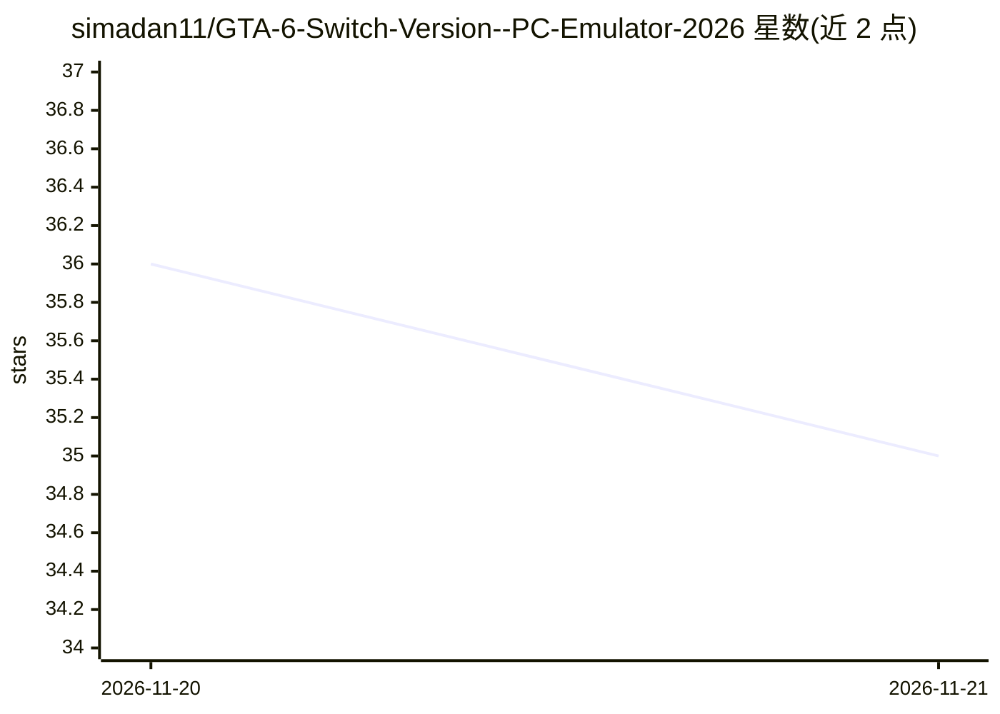

# simadan11/GTA-6-Switch-Version--PC-Emulator-2026

⭐ 35 · Rust · Apache-2.0 · 推送 2026-11-19 · [GitHub](https://github.com/simadan11/GTA-6-Switch-Version--PC-Emulator-2026) · 个人维护

**面向 Windows 玩家的 GTA VI PC 版安装准备与配置指南**

一个针对尚未发布 PC 版的 GTA VI 的 Windows 安装准备资源：提供系统兼容性检查清单、显卡驱动更新指引（NVIDIA/AMD/Intel 链接）、存储检查、Rockstar Games Launcher 准备步骤，以及通用的画质与 FPS 排障说明。仓库本身附带一个不含游戏文件的 Windows 安装器（.exe）。官方 PC 版发布日期与硬件要求截至文档撰写时均未公布，README 中多个表格字段标注为未确认。

## 筛选速览

| 维度 | 判定 | 备注 |
|---|---|---|
| AI 角色 | `ai-knowledge` | 知识聚合/清单类 |
| 许可风险 | `permissive` | Apache-2.0 |
| 部署形态 | `desktop` | 安装包/桌面程序 |
| 模型依赖 | — | README 未给出锁定关系 |
| 硬件要求 | — | 无带数字的原话,不猜 |
| 安装摩擦 | `low` | 无编译、无系统依赖或容器化 |
| 成熟度 | `idea` | |

## 能力要点

- Windows 兼容性准备清单（DirectX、驱动、存储、系统更新检查）
- 提供 NVIDIA/AMD/Intel 官方驱动下载链接
- 通用 FPS 优化与安装错误排障条目
- 附带不含 GTA VI 游戏文件的 Windows 配套安装器（.exe）

## 适用场景

- 为将来 GTA VI PC 版发布提前准备 Windows 环境
- 按步骤更新显卡驱动并检查系统兼容性
- 查阅 PC 游戏通用画质设置与 FPS 排障方法

## 场景标签

 · 领域:游戏/桌面工具

## 证据(README 行号)

> L5: A dedicated PC installation and configuration resource for Grand Theft Auto VI, covering Windows preparation, graphi
> L17: This repository is dedicated to Windows users preparing for the future PC edition of GTA VI.
> L30: The GTA VI PC release date and official hardware requirements have not yet been announced.

## 星数曲线

2026-11-20 36 → 2026-11-21 35（-1）

---
*卡片 v1 · prompt 1.4 · 生成 2026-11-20 · 置信度 mid · 依据 README sha `6954d37a13d3` · [字段定义](../../DATASET.md)*
