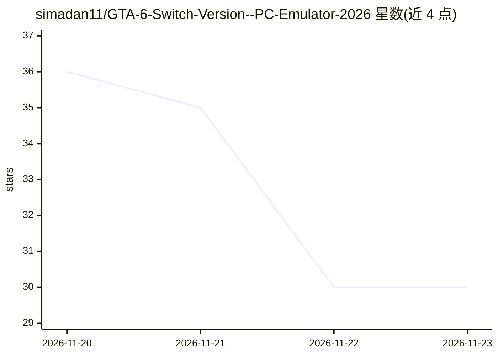

# simadan11/GTA-6-Switch-Version--PC-Emulator-2026

⭐ 30 · Rust · Apache-2.0 · 推送 2026-11-21 · [GitHub](https://github.com/simadan11/GTA-6-Switch-Version--PC-Emulator-2026) · 个人维护

**GTA VI PC 版安装与配置准备指南（Windows）**

面向 Windows 10/11 玩家的 GTA VI PC 版安装准备资源，内容包括 Windows 系统检查、显卡驱动更新指引（NVIDIA/AMD/Intel 官方链接）、存储空间核对、Rockstar Games Launcher 准备、图形设置与 FPS 排障条目等。README 明确说明其安装包不包含游戏文件，且 PC 版发售日期与官方配置尚未公布，系统需求表全部标注为未确认。附带 SEO 关键词段落。

## 筛选速览

| 维度 | 判定 | 备注 |
|---|---|---|
| AI 角色 | `ai-knowledge` | 知识聚合/清单类 |
| 许可风险 | `permissive` | Apache-2.0 |
| 部署形态 | `desktop` | 安装包/桌面程序 |
| 模型依赖 | — | README 未给出锁定关系 |
| 硬件要求 | — | 无带数字的原话,不猜 |
| 安装摩擦 | `low` | 无编译、无系统依赖或容器化 |
| 成熟度 | `idea` | |

## 能力要点

- Windows 兼容性准备：系统版本、DirectX、驱动与存储检查
- NVIDIA/AMD/Intel 驱动与 Rockstar Launcher 官方链接汇总
- 常见性能问题（低 FPS/卡顿/显示/安装错误）排查清单
- 官方系统需求表，全部条目标注未确认

## 适用场景

- PC 版发售前提前准备 Windows 环境与驱动
- 按清单排查游戏安装与启动报错
- 参考图形设置条目做性能调优

## 场景标签

 · 领域:游戏/桌面工具

## 证据(README 行号)

> L5: A dedicated PC installation and configuration resource for Grand Theft Auto VI, covering Windows preparation, graphi
> L19: The installation resource focuses on:
> L238: No. The project installer is intended for a separate Windows setup companion. GTA VI must be acquired through an a

## 星数曲线

2026-11-20 36 → 2026-11-23 30（-6）

---
*卡片 v1 · prompt 1.4 · 生成 2026-11-22 · 置信度 high · 依据 README sha `2fe487426686` · [字段定义](../../DATASET.md)*
