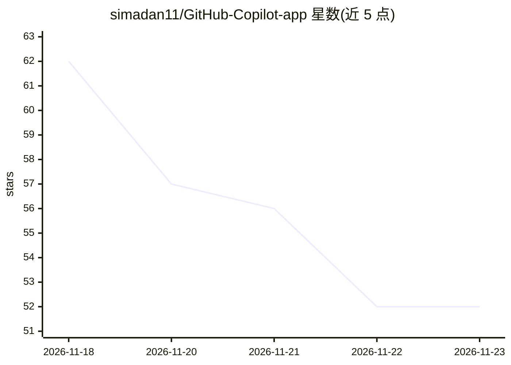

# simadan11/GitHub-Copilot-app

⭐ 52 · Apache-2.0 · 推送 2026-11-21 · [GitHub](https://github.com/simadan11/GitHub-Copilot-app) · 组织维护

**面向 GitHub 仓库的桌面端 Agent 开发工作管理应用**

GitHub 官方的桌面应用，定位为管理从想法到 pull request 全流程的 Agent 原生控制中心：查找工作、启动与引导编码 Agent、审查进度并落地变更。本地会话运行在隔离的 git worktree 中，云端会话在 GitHub 托管环境运行；提供 Canvases 展示 Agent 工作状态、My Work 聚合会话/issue/PR、Automations 定时任务与 Agent Merge 合并流程。需 Git 与 GitHub Copilot 订阅，无订阅时可通过 BYOK 自带模型 provider 使用。

## 筛选速览

| 维度 | 判定 | 备注 |
|---|---|---|
| AI 角色 | `ai-ecosystem` | LLM/agent 周边工具 |
| 许可风险 | `permissive` | Apache-2.0 |
| 部署形态 | `desktop` | 安装包/桌面程序 |
| 模型依赖 | — | README 未给出锁定关系 |
| 硬件要求 | — | 无带数字的原话,不猜 |
| 安装摩擦 | `low` | 无编译、无系统依赖或容器化 |
| 成熟度 | — | 结构信号不足 |

## 能力要点

- 本地会话在隔离 git worktree 中并行运行多个 Agent
- 云端会话在隔离的 GitHub 托管环境运行并可随处接续
- Canvases 提供 Agent 计划、终端、diff、工作流状态的可视化面板
- 无 Copilot 订阅时支持 BYOK 自带模型 provider

## 适用场景

- 同时让多个 Agent 并行调查 bug、实现 issue、处理 review 反馈
- 在单一界面聚合管理会话、issue、pull request
- 把重复性提示词变成定时或后台自动化任务

## 场景标签

`编码 Agent` · 领域:编码与开发

## 证据(README 行号)

> L3: The GitHub Copilot app is an agent-native desktop experience for finding, running, steering, and landing software wo
> L13: The GitHub Copilot app is an agent-native desktop experience for managing software work from idea to pull request. 
> L15: The app is built for parallel agent-driven development. Each local session runs in its own isolated git worktree, a

## 星数曲线

2026-11-18 62 → 2026-11-23 52（-10）

---
*卡片 v1 · prompt 1.4 · 生成 2026-11-19 · 置信度 high · 依据 README sha `f27c6eaa47bb` · [字段定义](../../DATASET.md)*
