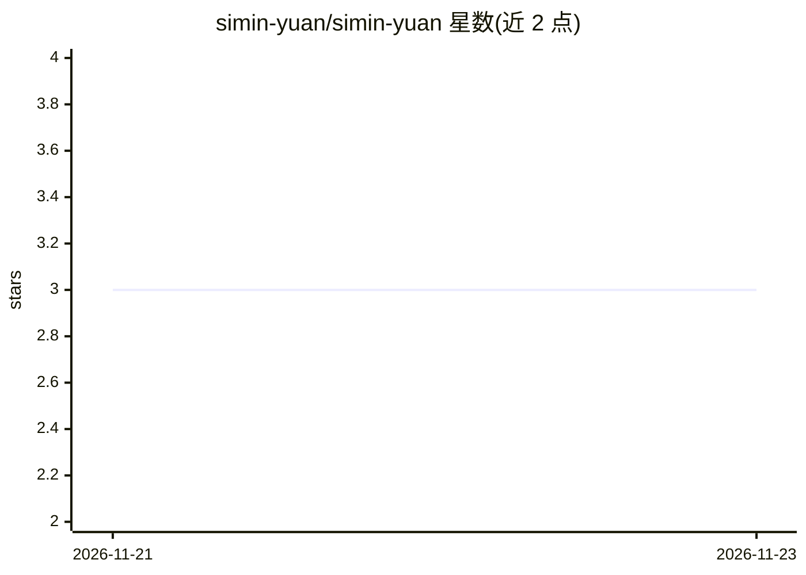

# simin-yuan/simin-yuan

⭐ 3 · Shell · CC-BY-4.0 · 推送 2026-11-17 · [GitHub](https://github.com/simin-yuan/simin-yuan) · 个人维护

**Agent 可靠性研究者个人主页：可复现证据与基准目录**

个人档案仓库，面向研究者与上游框架维护者。内容分四块：已合并的上游贡献清单（16 个项目的 33 个 PR，含 PR 号与改动说明）、三个已发布的安全通告（含 GHSA 编号与修复版本）、自研基准套件（故障注入式假端点测量 agent 自报与实际行为的偏差、重复执行、循环、截断工具调用、检索弃答率），以及 NeurIPS 2026 工作坊论文与 Zenodo 归档 DOI。所有条目附复现命令与归档数据，无安装或运行本仓库的说明。

## 筛选速览

| 维度 | 判定 | 备注 |
|---|---|---|
| AI 角色 | `ai-knowledge` | 知识聚合/清单类 |
| 许可风险 | `viral` | CC-BY-4.0 |
| 部署形态 | `None` |  |
| 模型依赖 | — | README 未给出锁定关系 |
| 硬件要求 | — | 无带数字的原话,不猜 |
| 安装摩擦 | `low` | 无编译、无系统依赖或容器化 |
| 成熟度 | — | 结构信号不足 |

## 能力要点

- 16 个上游项目 33 个已合并 PR 的清单（含 PR 号）
- 五个可复现的 agent 故障基准套件与 Zenodo 归档数据
- 三个 Hermes Agent 官方插件（degeneracy-guard/provenance-gate/skill-lineage）
- 三个 agent 记忆层安全通告，附回归测试

## 适用场景

- 查找 agent 框架已知故障模式及其上游修复记录
- 复现 agent 重复执行、循环、截断等缺陷的测量数据
- 了解 Hermes 插件目录中的可靠性门控组件

## 场景标签

`模型评测` · 领域:评测与运维

## 证据(README 行号)

> L19: ## Merged upstream contributions
> L59: One fake endpoint, the same measurement for every client. No API keys, no spend; anyone can rerun.
> L61: - **agent-faultbench** — an agent's self-report says it did A, the write on disk says it did B. A tool call cut off

## 星数曲线

2026-11-21 3 → 2026-11-23 3（+0）

---
*卡片 v1 · prompt 1.4 · 生成 2026-11-21 · 置信度 high · 依据 README sha `4143b59d5203` · [字段定义](../../DATASET.md)*
