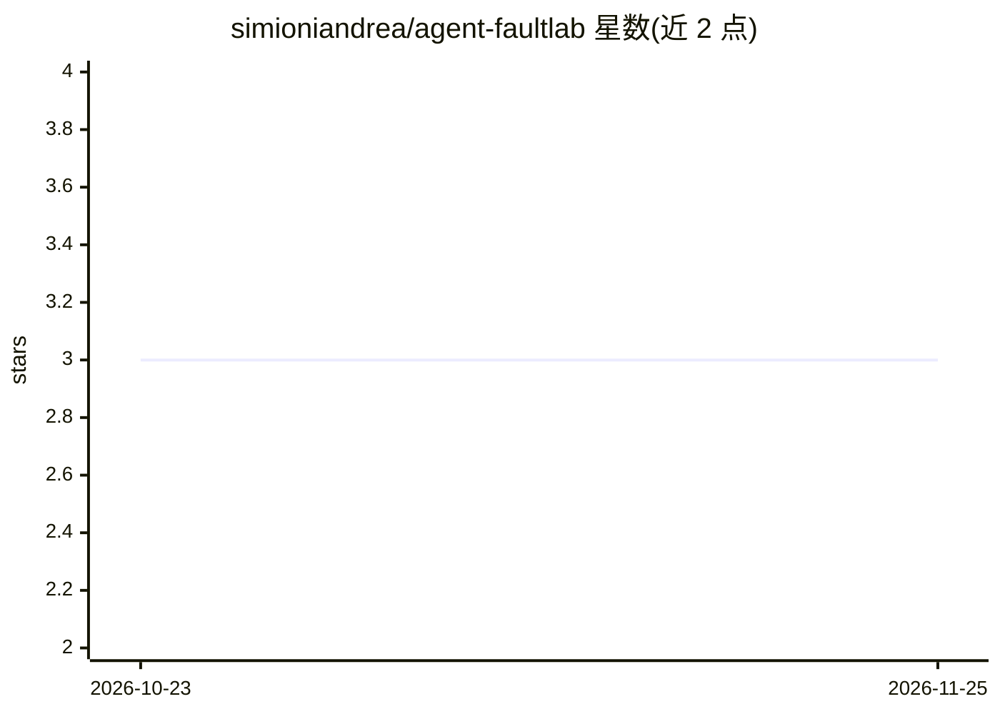

# simioniandrea/agent-faultlab

⭐ 3 · Python · MIT · 推送 2026-10-18 · [GitHub](https://github.com/simioniandrea/agent-faultlab) · 个人维护

**面向工具调用 agent 的故障注入测试框架，核验真实写入结果**

Agent FaultLab 向 agent 的工具调用与进程注入故障（响应丢失、超时、SIGKILL 进程杀死），再通过只读路径直接读取目标系统，检查是否产生重复记录、虚假声明等违例，输出 passed/failed/inconclusive/lab_error 四种裁决。提供 18 个内置场景、本地 Web UI、离线回放与 JUnit XML 输出。可接入自定义 LangGraph 图与自定义目标系统；实验仅覆盖单一记录类型的创建/查询两类调用，尚未在 CI 中验证。

## 筛选速览

| 维度 | 判定 | 备注 |
|---|---|---|
| AI 角色 | `ai-ecosystem` | LLM/agent 周边工具 |
| 许可风险 | `permissive` | MIT |
| 部署形态 | `library` | 以包/库形式分发 |
| 模型依赖 | local-ok | 支持本地模型 |
| 硬件要求 | — | 无带数字的原话,不猜 |
| 安装摩擦 | `low` | 无编译、无系统依赖或容器化 |
| 成熟度 | `idea` | |

## 能力要点

- 故障注入后独立读取目标系统而非信任 agent 自述报告
- 真实 SIGKILL 进程杀死故障与幂等键协调场景
- 支持自定义 LangGraph 图与自定义目标系统（--graph-factory/--target）
- 离线录制回放检测 agent 行为变化

## 适用场景

- 测试我的 agent 在超时后是否盲目重试造成重复提交
- 验证代码改动没有改变 agent 的工具调用行为
- 在 CI 中对 agent 场景输出 JUnit XML 测试结果

## 场景标签

`模型评测` · 领域:评测与运维

## 证据(README 行号)

> L5: **Crash-test AI agents that change things in the real world.** Agent FaultLab injects failures into an agent's tool 
> L27: 4. **Observe.** FaultLab reads the target system directly, through a read-only path the agent never touches, and ch
> L100: Write a factory that builds your graph around the two tool callables FaultLab passes in, then name it on the comma

## 星数曲线

2026-10-23 3 → 2026-11-25 3（+0）

---
*卡片 v1 · prompt 1.4 · 生成 2026-11-21 · 置信度 high · 依据 README sha `b58a95490d0f` · [字段定义](../../DATASET.md)*
