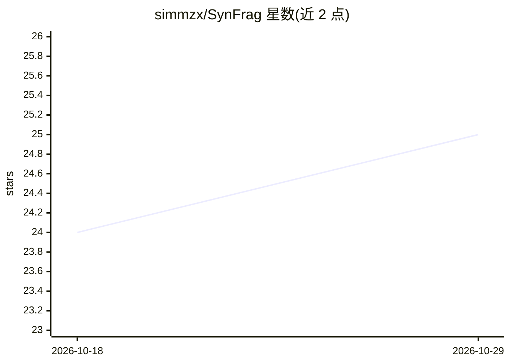

# simmzx/SynFrag

⭐ 25 · Python · MIT · 推送 2026-07-03 · [GitHub](https://github.com/simmzx/SynFrag) · 组织维护 · 中文 README

**药物发现中预测分子合成可及性的片段组装生成模型**

面向药物发现研究者，基于片段组装自回归生成预训练（918 万无标注分子）与 80 万标注分子微调的两阶段流程，预测分子的合成可及性（SA）评分，并以片段组装模式与注意力热图提供化学可解释性；支持识别合成难度悬崖与多步反应中间体的相对 SA。使用方式：输入 CSV 或 SMILES 运行预测脚本输出评分（≥0.5 易合成，阈值可按高通量筛选/资源受限场景调整），亦支持自定义预训练与微调管线；另有免费在线平台。训练要求 4 块 V100 GPU，依赖 PyTorch/RDKit/DGL/DeepChem 等。

## 筛选速览

| 维度 | 判定 | 备注 |
|---|---|---|
| AI 角色 | `ai-native` | 本体是模型或模型工具 |
| 许可风险 | `permissive` | MIT |
| 部署形态 | `library` | 以包/库形式分发 |
| 模型依赖 | — | README 未给出锁定关系 |
| 硬件要求 | — | 无带数字的原话,不猜 |
| 安装摩擦 | `low` | 无编译、无系统依赖或容器化 |
| 成熟度 | — | 结构信号不足 |

## 能力要点

- 两阶段训练：918 万分子片段组装预训练 + 80 万标注分子微调
- SA 评分输出附片段组装模式与反应位点注意力热图可解释性
- 支持自定义化学空间的预训练与微调管线
- 提供免费在线平台（含逆合成工具集成）

## 适用场景

- 药物发现中批量筛选分子的合成可及性
- 判断候选分子是否处于合成难度悬崖
- 评估多步合成路线中间体的相对合成难度
- 在专有化合物库上自定义预训练微调

## 场景标签

 · 领域:药物发现/化学信息学

## 证据(README 行号)

> L8:  Synthetic Accessibility Predictor based on Fragment Assembly Generation
> L20: * **Stage 1**: Pretrain on 9.18M unlabeled molecules to learn fragment assembly patterns.
> L21: * **Stage 2**: Finetune on 800K labeled molecules to transfer the knowledge in SA prediction.

## 星数曲线

2026-10-18 24 → 2026-10-29 25（+1）

---
*卡片 v1 · prompt 1.4 · 生成 2026-10-27 · 置信度 high · 依据 README sha `93839bf04380` · [字段定义](../../DATASET.md)*
