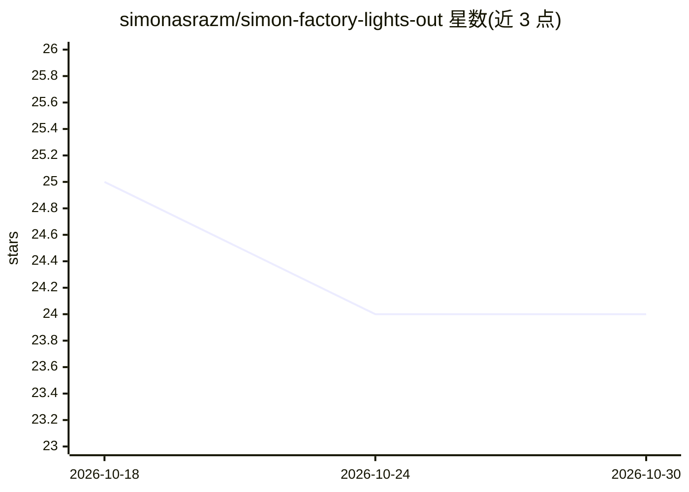

# simonasrazm/simon-factory-lights-out

⭐ 24 · Python · MIT · 推送 2026-09-14 · [GitHub](https://github.com/simonasrazm/simon-factory-lights-out) · 个人维护

**用 AI agent 流水线自动构建软件的门控协议**

面向 AI agent 开发者的软件构建流水线协议：六个串行阶段（发现、开发、QA、安全等）各自必须产出规定工件，无工件则不推进。Scout 读取各 agent 的 BRIEF.md 按任务匹配角色；通过 pipeline.yaml 配置模型、阈值与运行时，支持 Codex、Cursor、Claude Code、OpenClaw 作为运行时，将 sflo 技能安装到对应技能目录后由 agent 驱动执行。附带 CLI runner 支持并行工厂、断点续跑，并 vendor 了 Matt Pocock 的工程技能快照。README 顶部声明另一变体 Waydriver 效果更好。

## 筛选速览

| 维度 | 判定 | 备注 |
|---|---|---|
| AI 角色 | `ai-ecosystem` | LLM/agent 周边工具 |
| 许可风险 | `permissive` | MIT |
| 部署形态 | `None` |  |
| 模型依赖 | — | README 未给出锁定关系 |
| 硬件要求 | — | 无带数字的原话,不猜 |
| 安装摩擦 | `low` | 无编译、无系统依赖或容器化 |
| 成熟度 | — | 结构信号不足 |

## 能力要点

- 六阶段门控流水线：每阶段产出必需工件，无工件不推进
- Scout 读取 BRIEF.md 自动匹配 agent 角色，可自定义 agent 目录
- 安装为单个自包含 sflo 技能，支持 Codex/Cursor/Claude Code/OpenClaw 运行时
- pipeline.yaml 作为模型、阈值、门与运行时策略的唯一配置源

## 适用场景

- 让 AI agent 按门控流程自动完成从需求到交付的软件开发
- 在同一项目中并行运行多个工厂目录互不干扰
- 通过自定义 agent 与 pipeline.yaml 调整流水线行为

## 场景标签

`编码 Agent` · 领域:编码与开发

## 证据(README 行号)

> L5: A gated pipeline protocol for building software with AI agents. Six sequential stages — each producing a required ar
> L22: > Install SFLO from https://github.com/simonasrazm/simon-factory-lights-out
> L72: Pipeline starts and resumes require an explicit `--runtime`.

## 星数曲线

2026-10-18 25 → 2026-10-30 24（-1）

---
*卡片 v1 · prompt 1.4 · 生成 2026-10-27 · 置信度 high · 依据 README sha `c8e03e3ba3d3` · [字段定义](../../DATASET.md)*
