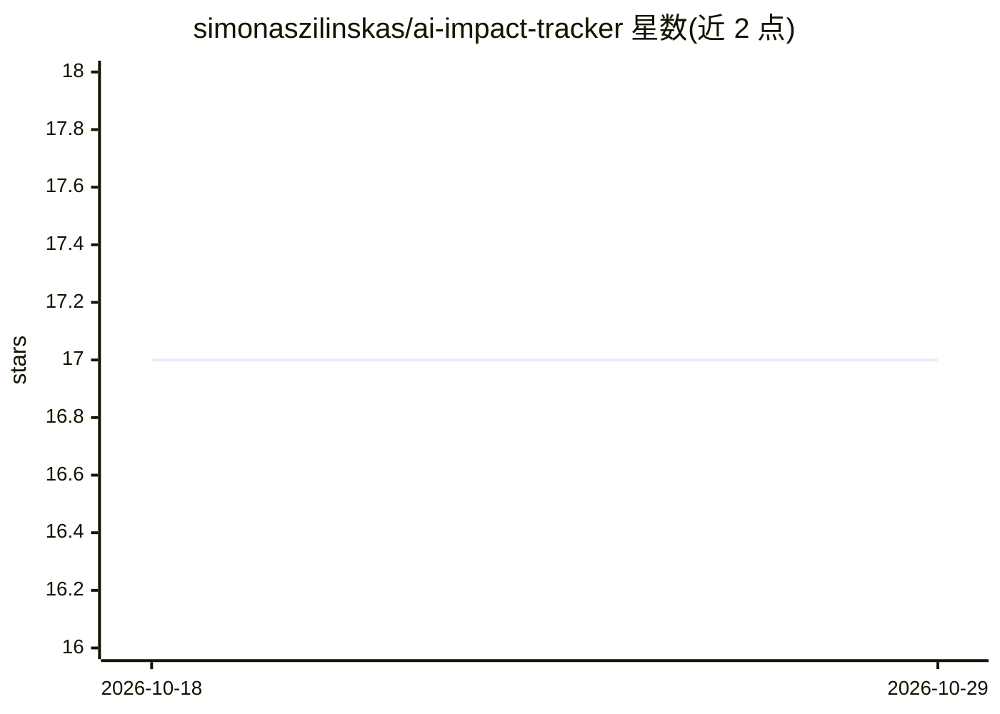

# simonaszilinskas/ai-impact-tracker

⭐ 17 · JavaScript · GPL-3.0 · 推送 2026-02-18 · [GitHub](https://github.com/simonaszilinskas/ai-impact-tracker) · [官网](https://ai-impact.tortue.studio/) · 个人维护

**估算 ChatGPT 对话能耗环境影响的 Chrome 扩展**

面向个人用户的 Chrome 浏览器扩展（当前仅支持 Chrome），监控用户与 ChatGPT 的对话并基于 EcoLogits v0.9.x 方法论估算每次交互的能耗：通过追踪发送的消息并按回复字符长度估计输出 token 数来计算能源足迹。提供 YouTube 流媒体时长、60W 灯泡、手机充电、电梯行程等日常等价物对照，以及每日与累计统计。数据全部本地处理，不收集数据。当前仅支持 ChatGPT，计划支持更多 AI 平台，可从 Chrome Web Store 安装。

## 筛选速览

| 维度 | 判定 | 备注 |
|---|---|---|
| AI 角色 | `ai-enhanced` | 去掉 AI 部分产品仍成立 |
| 许可风险 | `viral` | GPL-3.0 |
| 部署形态 | `None` |  |
| 模型依赖 | — | README 未给出锁定关系 |
| 硬件要求 | — | 无带数字的原话,不猜 |
| 安装摩擦 | `low` | 无编译、无系统依赖或容器化 |
| 成熟度 | `idea` | |

## 能力要点

- 基于 EcoLogits v0.9.x 方法学的能耗估算
- 以 YouTube 时长、灯泡、手机充电、电梯等日常等价物呈现影响
- 每日与累计使用统计
- 本地处理，不收集数据

## 适用场景

- 查看我与 ChatGPT 对话消耗的能源
- 通过日常等价物理解 AI 使用的环境足迹
- 追踪每日与长期的 AI 使用累计影响

## 场景标签

 · 领域:环境可持续性/浏览器工具

## 证据(README 行号)

> L3: A browser extension (for now only Chrome) that estimates the environmental impact of your AI interactions.
> L14: - **Real-time Energy Tracking**: Monitors your ChatGPT conversations and calculates energy consumption

## 星数曲线

2026-10-18 17 → 2026-10-29 17（+0）

---
*卡片 v1 · prompt 1.4 · 生成 2026-10-29 · 置信度 high · 依据 README sha `e0a499ca1e39` · [字段定义](../../DATASET.md)*
