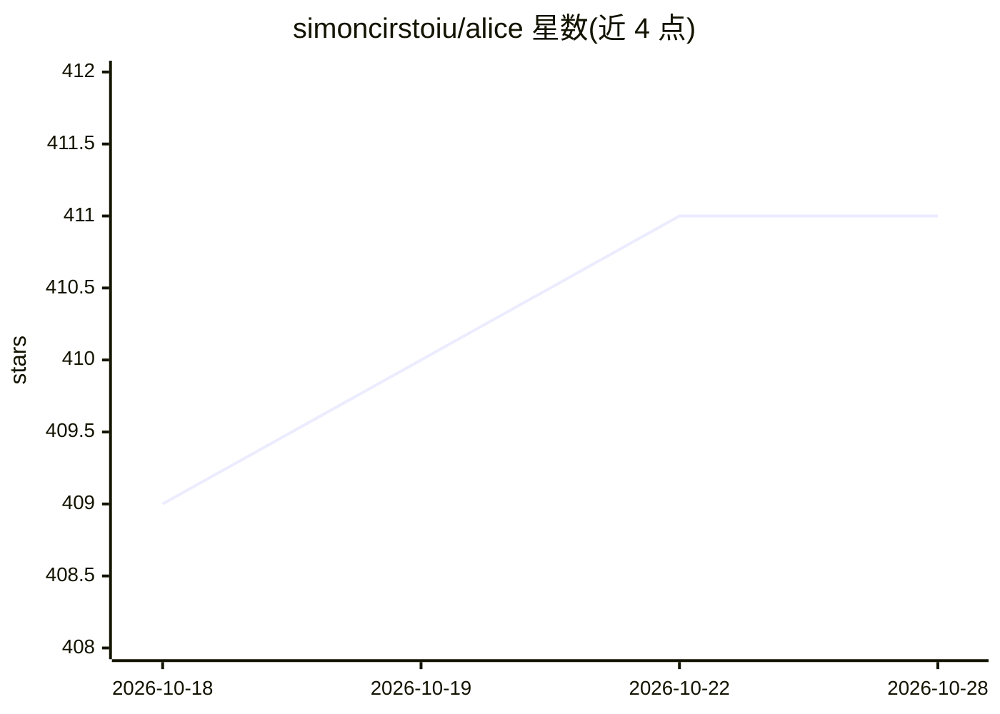

# simoncirstoiu/alice

⭐ 411 · JavaScript · NOASSERTION · 推送 2026-10-28 · [GitHub](https://github.com/simoncirstoiu/alice) · 个人维护

**面向 Frigate 摄像头的 YOLO 数据集标注、训练与管理工具包**

以 Python 编写、通过浏览器（localhost:8080）操作的 YOLO 数据集管理工具：提供画布级边界框标注、pHash 去重、Frigate NVR 快照/视频导入、YOLO 推理自动标注、五步训练流水线（导出→去重→自动标注→训练→ONNX 导出）。自动检测 NVIDIA GPU/CPU 并选择对应 PyTorch 与 onnxruntime 变体，GPU 需用户自行安装 NVIDIA 驱动与 CUDA。源码模块经 builder.py 组装为单文件 alice.py 运行，也支持生成 docker-compose 部署。许可为 PolyForm Noncommercial，商用需另行联系。

## 筛选速览

| 维度 | 判定 | 备注 |
|---|---|---|
| AI 角色 | `ai-native` | 本体是模型或模型工具 |
| 许可风险 | `none` | NOASSERTION |
| 部署形态 | `self-host` | docker 或自建部署 |
| 模型依赖 | — | README 未给出锁定关系 |
| 硬件要求 | `cpu-ok` | |
| 安装摩擦 | `low` | 无编译、无系统依赖或容器化 |
| 成熟度 | — | 结构信号不足 |

## 能力要点

- 画布编辑器标注 YOLO 边界框，支持撤销/快捷键/画廊视图
- 五步训练流水线：导出、pHash 去重、教师模型自动标注、训练、ONNX 导出
- 自动检测 NVIDIA GPU/CPU 并选择对应 PyTorch 与 onnxruntime 变体
- 从 Frigate 数据库导入快照并自动 WebP→JPG 转换

## 适用场景

- 用自家摄像头画面训练定制 YOLO 检测模型
- 管理、标注与去重 YOLO 格式数据集
- 将 Frigate NVR 的事件快照转入训练集并导出 ONNX 部署

## 场景标签

`目标检测` `微调` · 领域:感知与多模态

## 证据(README 行号)

> L3:  All-in-one AI-powered image annotation, training, and dataset management toolkit.
> L92: |**4. Train**|Fine-tune student model with real-time metrics (loss, mAP50, mAP50-95)|

## 星数曲线

2026-10-18 409 → 2026-10-28 411（+2）

---
*卡片 v1 · prompt 1.4 · 生成 2026-10-21 · 置信度 high · 依据 README sha `f90c0f0dc324` · [字段定义](../../DATASET.md)*
