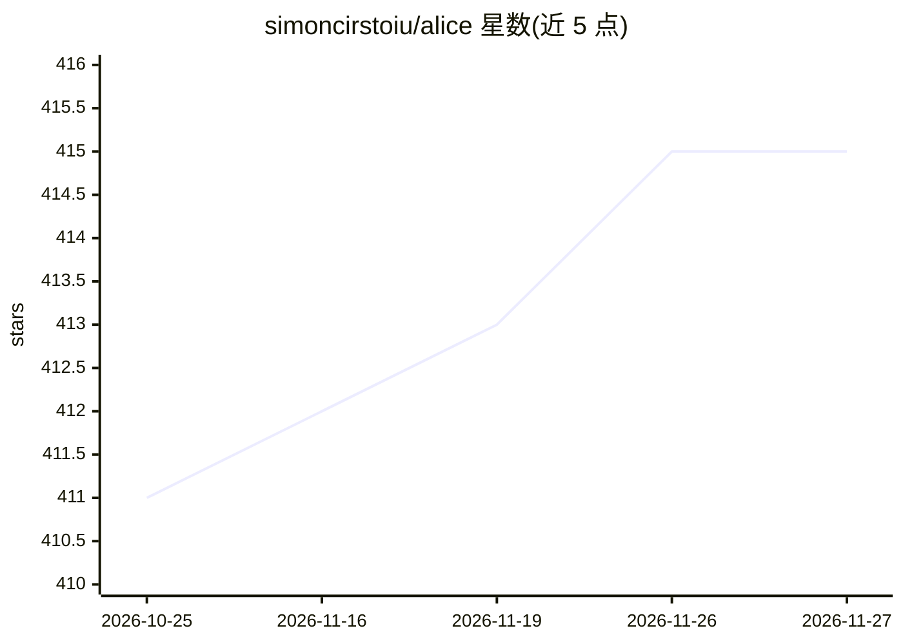

# simoncirstoiu/alice

⭐ 415 · JavaScript · NOASSERTION · 推送 2026-11-07 · [GitHub](https://github.com/simoncirstoiu/alice) · 个人维护

**面向 Frigate 摄像头用户的 YOLO 数据集标注与训练工具包**

为 Frigate NVR 摄像头场景构建的一体化图像标注、训练与数据集管理工具：浏览/标注 YOLO 边界框、pHash 去重、从 Frigate 快照与视频转入训练集、对图像运行 YOLO 推理并合并检测结果，以及五步训练管线（导出→去重→教师模型自动标注→微调→ONNX 导出）。启动时自动检测 NVIDIA GPU 或回退 CPU，依赖通过 Web 欢迎页一键安装；以单体 Python 脚本形式由 builder 组装，也支持 Docker。许可证为 PolyForm 非商业，商业用途需另行联系。

## 筛选速览

| 维度 | 判定 | 备注 |
|---|---|---|
| AI 角色 | `ai-native` | 本体是模型或模型工具 |
| 许可风险 | `none` | NOASSERTION |
| 部署形态 | `self-host` | docker 或自建部署 |
| 模型依赖 | — | README 未给出锁定关系 |
| 硬件要求 | `cpu-ok` | |
| 安装摩擦 | `low` | 无编译、无系统依赖或容器化 |
| 成熟度 | — | 结构信号不足 |

## 能力要点

- 五步训练管线：导出/去重/自动标注/微调/ONNX 导出，各步可单独运行
- 自动检测 NVIDIA GPU 与 CPU 并适配，无需手动配置
- pHash（DCT 64 位哈希）+ 框相似度去重，多进程加速
- 读取 Frigate NVR 事件快照与视频导出，一键转入训练集

## 适用场景

- 用自家摄像头图像训练适配自家场景的 YOLO 模型
- 标注与管理 YOLO 格式数据集（画框、去重、统计）
- 将 Frigate 历史快照批量转为训练数据
- 训练后导出 ONNX 部署模型

## 场景标签

`目标检测` `微调` · 领域:感知与多模态

## 证据(README 行号)

> L3:  All-in-one AI-powered image annotation, training, and dataset management toolkit.
> L81: Run YOLO inference on any image across all three modes. Merge detected boxes into annotations (dedup by IoU > 0.5).
> L92: |**4. Train**|Fine-tune student model with real-time metrics (loss, mAP50, mAP50-95)|

## 星数曲线

2026-10-25 411 → 2026-11-27 415（+4）

---
*卡片 v1 · prompt 1.4 · 生成 2026-11-25 · 置信度 high · 依据 README sha `9c9a499c7679` · [字段定义](../../DATASET.md)*
