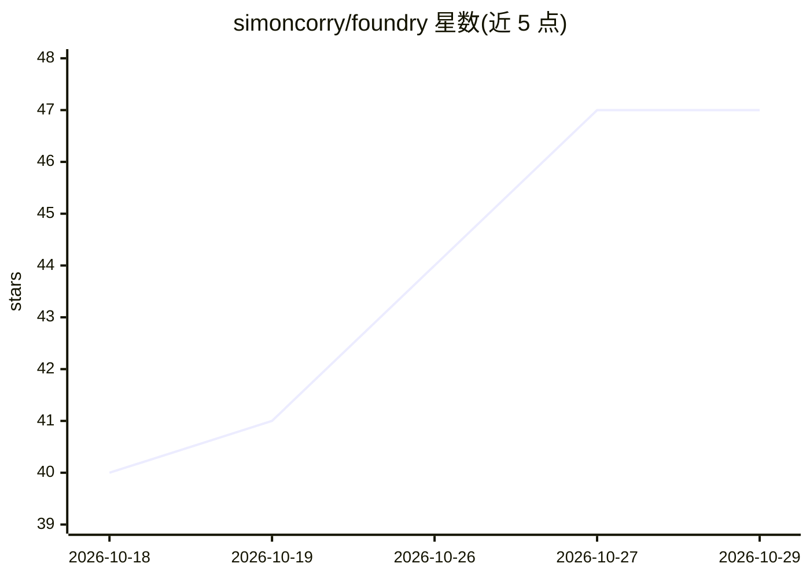

# simoncorry/foundry

⭐ 47 · JavaScript · MIT · 推送 2026-10-07 · [GitHub](https://github.com/simoncorry/foundry) · [官网](https://simoncorry.com/blog/2026/07/15/design-process-meet-agent-process) · 个人维护

**在现有编码 Agent 工具内运行的软件开发流程命令集**

Foundry 是一套由 20 个 markdown 命令文件组成的 agent 流程，运行在用户已有的编码工具（Cursor、Claude Code、Codex）内部：十个阶段按序执行，含计划构建、用户访谈、五轮计划质疑、实现、测试、安全扫描、五轮实现质疑、收尾与交接，另有 Quiz 与 Solo 两个可选环节。配套 sessions 日志与 wiki 记忆文件夹跨会话保留上下文。中等规模功能全流程约消耗数十万 token。以 git clone 仓库方式使用。

## 筛选速览

| 维度 | 判定 | 备注 |
|---|---|---|
| AI 角色 | `ai-ecosystem` | LLM/agent 周边工具 |
| 许可风险 | `permissive` | MIT |
| 部署形态 | `None` |  |
| 模型依赖 | — | README 未给出锁定关系 |
| 硬件要求 | — | 无带数字的原话,不猜 |
| 安装摩擦 | `low` | 无编译、无系统依赖或容器化 |
| 成熟度 | — | 结构信号不足 |

## 能力要点

- 十个阶段加两个可选环节，共 20 个 markdown 命令文件
- 五轮计划质疑与五轮实现质疑的多角度审查机制
- sessions 日志与 wiki 提供跨会话记忆
- 提供 light 路径（每侧两轮质疑替代五轮）

## 适用场景

- 在 Cursor/Claude Code/Codex 中按结构化流程开发长期维护的项目
- 通过 Solo 指令让 agent 无人值守跑完剩余阶段
- 用 Quiz 复习并理解刚合并的变更

## 场景标签

`编码 Agent` `提示工程` · 领域:Agent 开发

## 证据(README 行号)

> L7: Your coding tool (Cursor, Claude Code, Codex, whatever) is the harness: the thing that holds the agent, its permissi
> L11: There are ten stages plus two optional riders, and each one is a plain markdown command the agent reads. That's twe

## 星数曲线

2026-10-18 40 → 2026-10-29 47（+7）

---
*卡片 v1 · prompt 1.4 · 生成 2026-10-25 · 置信度 high · 依据 README sha `3547696058c2` · [字段定义](../../DATASET.md)*
