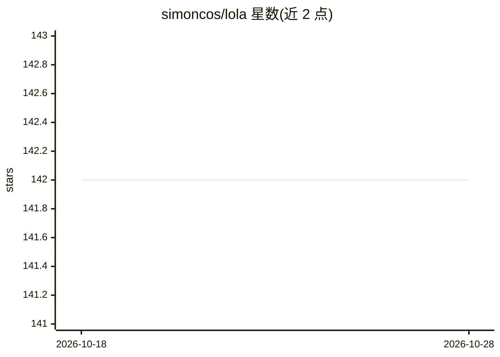

# simoncos/lola

⭐ 142 · Python · 推送 2026-08-10 · [GitHub](https://github.com/simoncos/lola) · 个人维护

**英雄联盟对局数据挖掘与预测的历史课程项目（存档状态）**

围绕 Riot API 与 Cassiopeia 封装的历史性数据分析项目：单种子爬虫抓取对局数据入 SQLite，提供关系矩阵/预处理、聚类原型、英雄排名与对局预测原型。默认分支为存档基线：无依赖锁定与 CI，聚类与预测为历史原型，未能复现报告中的多种子协议与 220k/31 特征实验；反作弊检测未实现。数据集以 Google Drive 链接分发，缺数据卡、许可与隐私审查记录，README 提示使用前需自行核验来源与合规。

## 筛选速览

| 维度 | 判定 | 备注 |
|---|---|---|
| AI 角色 | `ai-native` | 本体是模型或模型工具 |
| 许可风险 | `none` | — |
| 部署形态 | `None` |  |
| 模型依赖 | — | README 未给出锁定关系 |
| 硬件要求 | — | 无带数字的原话,不猜 |
| 安装摩擦 | `low` | 无编译、无系统依赖或容器化 |
| 成熟度 | — | 结构信号不足 |

## 能力要点

- 基于 Riot API + Cassiopeia 的单种子爬虫，SQLite 存储
- 矩阵/预处理已实现，带合成 SQLite 夹具的单元测试
- 包含聚类、英雄排名、推荐与对局预测的历史原型代码
- 明确标注存档状态：无依赖锁定、未验证与当前 API 的兼容性

## 适用场景

- 参考历史对局数据爬取与预处理流程
- 复用关系矩阵与预处理代码用于自己的对局分析
- 以课程报告为线索研究 2016 赛季对局预测方法

## 场景标签

`数据分析` · 领域:效率与自动化

## 证据(README 行号)

> L60: The legacy tree contains champion ranking, relationship matrices, clustering,
> L61: recommendation experiments, and a match-prediction prototype. The narrow test

## 星数曲线

2026-10-18 142 → 2026-10-28 142（+0）

---
*卡片 v1 · prompt 1.4 · 生成 2026-10-22 · 置信度 high · 依据 README sha `0841bbebebd5` · [字段定义](../../DATASET.md)*
