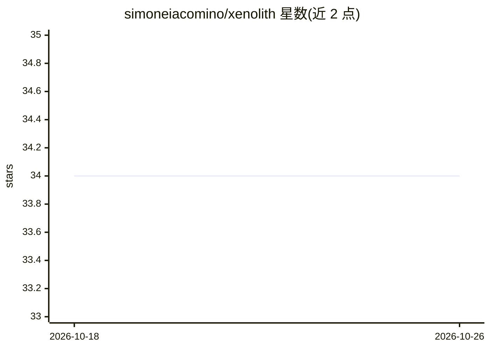

# simoneiacomino/xenolith

⭐ 34 · C · MIT · 推送 2026-10-20 · [GitHub](https://github.com/simoneiacomino/xenolith) · 个人维护

**面向 Intel Xe 核显的纯 C 本地推理引擎（单一目标模型 Gemma 4 26B-A4B QAT）**

用纯 C 编写的本地 LLM 推理引擎，针对 Intel Xe-LP 集成显卡（11–13 代移动平台）、32 GB RAM、Linux 与单一目标模型 Gemma 4 26B-A4B QAT GGUF 设计和调优。核心机制：prefill 阶段利用 GPU 并行、decode 阶段用 CPU 利用带宽，以获得更均衡的表现；通过 Level Zero（intel-compute-runtime）访问 GPU，按设备 ID 跟踪兼容性（大量未测试）。提供有状态会话协议、C API、实验性图像输入。需 make 源码编译并安装 Level Zero 与 Intel GPU 运行时，无内部 agent/harness。

## 筛选速览

| 维度 | 判定 | 备注 |
|---|---|---|
| AI 角色 | `ai-ecosystem` | LLM/agent 周边工具 |
| 许可风险 | `permissive` | MIT |
| 部署形态 | `None` |  |
| 模型依赖 | — | README 未给出锁定关系 |
| 硬件要求 | — | 无带数字的原话,不猜 |
| 安装摩擦 | `medium` | 含编译或系统依赖之一 |
| 成熟度 | `idea` | |

## 能力要点

- prefill 用 GPU / decode 用 CPU 的分阶段执行策略
- 纯 C 实现，经 Level Zero 运行于 Intel Xe 系核显
- 有状态会话协议与 C API 供客户端接入
- 实验性图像输入（PNG/JPEG，mmproj 投影）

## 适用场景

- 在 Intel 核显轻薄本上运行 Gemma 4 26B-A4B QAT 模型
- 通过有状态协议把自有 harness/客户端接入本地推理
- 对单张图片做多轮问答

## 场景标签

`推理引擎` · 领域:训练与推理

## 证据(README 行号)

> L1: # What is Xenolith
> L2: Xenolith is a pure C inference engine designed and optimized for Intel Xe-LP iGPUs (11th–13th gen mobile), 32 GB RAM

## 星数曲线

2026-10-18 34 → 2026-10-26 34（+0）

---
*卡片 v1 · prompt 1.4 · 生成 2026-10-25 · 置信度 high · 依据 README sha `34058ac84821` · [字段定义](../../DATASET.md)*
