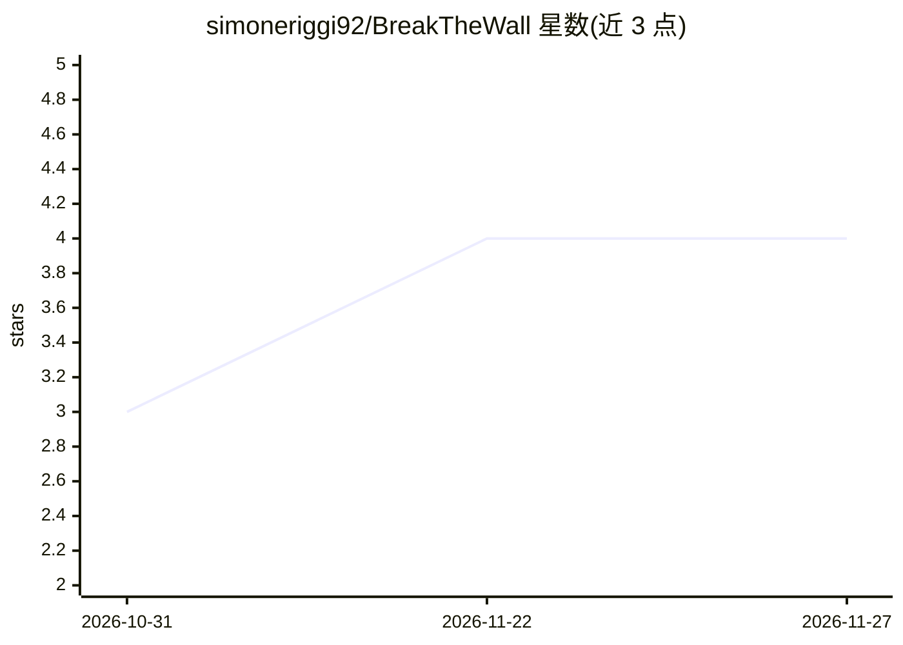

# simoneriggi92/BreakTheWall

⭐ 4 · TypeScript · Apache-2.0 · 推送 2026-11-26 · [GitHub](https://github.com/simoneriggi92/BreakTheWall) · 个人维护

**面向读 AI 长文开发者的文本结构交互探索桌面应用**

Electron 桌面应用（macOS/Windows），把文本（粘贴或 .txt/.md）解析为可探索的层级结构：方面、角色、组件、链接，每块都回指源文行号；链接标注是原文声明还是推断。结构由 Claude Desktop/Claude Code 或 ChatGPT（实验）生成，应用在保留前核验每条引用行与链接是否存在。自带预制探索无需账号；数据本地保存，提供覆盖度与推断基础的阅读报告。Apache-2.0，alpha 阶段。

## 筛选速览

| 维度 | 判定 | 备注 |
|---|---|---|
| AI 角色 | `ai-enhanced` | 去掉 AI 部分产品仍成立 |
| 许可风险 | `permissive` | Apache-2.0 |
| 部署形态 | `desktop` | 安装包/桌面程序 |
| 模型依赖 | locked-api |  |
| 硬件要求 | — | 无带数字的原话,不猜 |
| 安装摩擦 | `low` | 无编译、无系统依赖或容器化 |
| 成熟度 | `idea` | |

## 能力要点

- 结构逐级下钻（aspect→role→component）并回指源文行
- 应用自动核验引用行存在、链接端点存在、推断链接须标注
- 本地阅读报告：覆盖率、结构规模、声明/推断链接数
- macOS/Windows 安装包，支持 Apple Silicon DMG 与 Windows x64 setup

## 适用场景

- 开发者核验 AI 写的设计文档、runbook 是否说得通
- 逐行对照 AI 回答与其引用的源文位置
- 离线浏览随应用附带的预制结构探索

## 场景标签

 · 领域:开发者/知识工具

## 证据(README 行号)

> L5:  AI writes design docs, runbooks and long answers faster than anyone can read them. Break the Wall reads their struc
> L32: You ask an AI how something works, or it writes the design doc, the runbook or the release notes for you. The answe
> L58: |**Give a source**|Paste text or pick a `.txt` / `.md` file in Studio, or ask Claude to explore an explanation it w

## 星数曲线

2026-10-31 3 → 2026-11-27 4（+1）

---
*卡片 v1 · prompt 1.4 · 生成 2026-11-21 · 置信度 high · 依据 README sha `d6431c8b97f5` · [字段定义](../../DATASET.md)*
