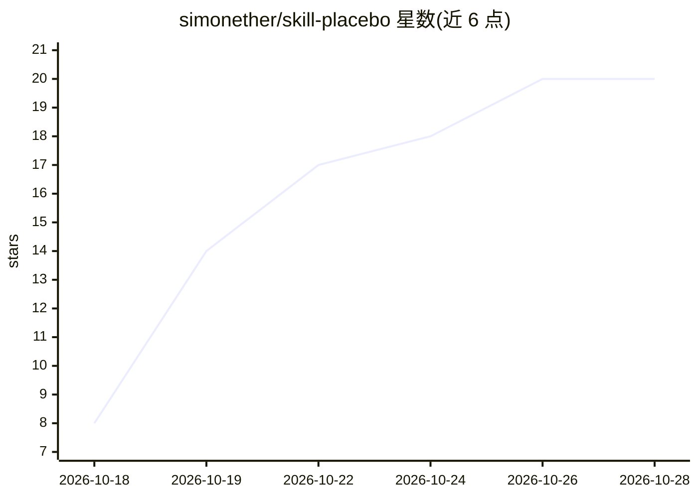

# simonether/skill-placebo

⭐ 22 · Shell · MIT · 推送 2026-10-06 · [GitHub](https://github.com/simonether/skill-placebo) · 个人维护

**对热门编码 agent 技能做安慰剂对照评测的基准**

对 9 个高星编码 agent 技能进行安慰剂对照测试：每个技能在无技能、同长度中性安慰剂文本、技能三组臂上运行相同任务，比较成本与通过率（Holm 校正）。主实验在 Claude Code（claude-opus-5-5）上完成 450 次试验，Codex 仅做了小型试点；结果为 2 个技能优于安慰剂、1 个更差、6 个无差异。附带技能作者声称数值与实测的对照表、公开的逐次试验记录、METHOD.md 预注册方法及 uvx 复现命令。

## 筛选速览

| 维度 | 判定 | 备注 |
|---|---|---|
| AI 角色 | `ai-ecosystem` | LLM/agent 周边工具 |
| 许可风险 | `permissive` | MIT |
| 部署形态 | `None` |  |
| 模型依赖 | — | README 未给出锁定关系 |
| 硬件要求 | — | 无带数字的原话,不猜 |
| 安装摩擦 | `low` | 无编译、无系统依赖或容器化 |
| 成熟度 | — | 结构信号不足 |

## 能力要点

- 三臂设计：无技能/同长度安慰剂/技能，安慰剂以相同机制安装
- 450 次试验，Holm 校正判定，逐次试验与代理日志公开
- 技能 README 声称数值与实测结果的对照表
- uvx skill-placebo run <owner/repo> 一行复现单个技能

## 适用场景

- 判断某编码 agent 技能是否比同长度中性文本带来实际收益
- 技能作者核验自家技能在公开基准下的成本与通过率表现
- 了解公开技能生态声称效果与实测的差距

## 场景标签

`模型评测` · 领域:评测与运维

## 证据(README 行号)

> L5: **A placebo-controlled test of the most-starred skills for coding agents: does a skill do better than the same amoun
> L74: - Every skill runs in three arms on the same tasks: no skill, placebo, skill.

## 星数曲线

2026-10-18 8 → 2026-10-28 20（+12）

---
*卡片 v1 · prompt 1.4 · 生成 2026-10-28 · 置信度 high · 依据 README sha `a00eb24c7971` · [字段定义](../../DATASET.md)*
