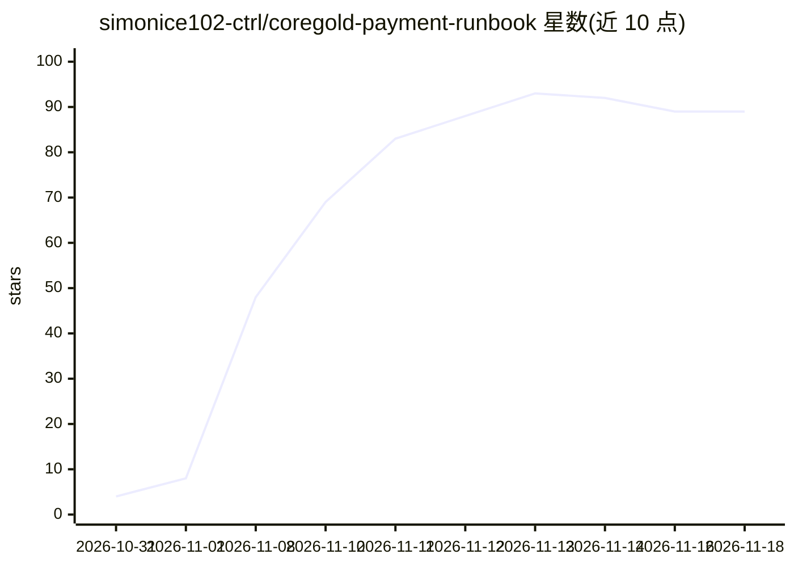

# simonice102-ctrl/coregold-payment-runbook

⭐ 89 · 推送 2026-10-30 · [GitHub](https://github.com/simonice102-ctrl/coregold-payment-runbook) · [官网](https://app.coregold.io/signup?invite_code=ADvlj9b) · 个人维护 · 中文 README

**海外绑卡与支付报错排查手册，配套 CoreGold 虚拟卡操作流程**

一份面向个人用户的中文运行手册（Runbook），内容为在海外平台绑定信用卡、充值 API、订阅工具时遇到的风控拦截问题的排查方法：包含常见报错（卡片被拒、AVS 邮编不匹配、3DS 不支持、预授权失败）的成因与对策表、绑卡前浏览器/IP/时区/账单地址的环境自检清单，以及基于 CoreGold 虚拟卡的 USDT 充值、开卡、录入、扣款的标准流转流程。仓库内嵌 CoreGold 官方控制台与带邀请码的注册链接。

## 筛选速览

| 维度 | 判定 | 备注 |
|---|---|---|
| AI 角色 | `ai-knowledge` | 知识聚合/清单类 |
| 许可风险 | `none` | — |
| 部署形态 | `None` |  |
| 模型依赖 | — | README 未给出锁定关系 |
| 硬件要求 | — | 无带数字的原话,不猜 |
| 安装摩擦 | `low` | 无编译、无系统依赖或容器化 |
| 成熟度 | — | 结构信号不足 |

## 能力要点

- 4 类常见支付报错的成因排查与对策速查表
- 绑卡前的浏览器、IP 属地、时区与账单地址自检清单
- USDT 充值到 CoreGold 虚拟卡的四步标准化流转流程

## 适用场景

- 绑卡被拒或 AVS 校验失败时对照排查
- 订阅海外 SaaS 或充值 API 前检查支付环境配置
- 了解 CoreGold 虚拟卡的开卡与用卡流程

## 场景标签

 · 领域:支付/金融工具文档

## 证据(README 行号)

> L5: > **关于本手册**：专门排查并解决在海外平台绑定信用卡、充值 API、订阅工具时遇到的各类拦截问题。包含常见错误码速查、底层判定逻辑，以及如何利用 **CoreGold** 虚拟卡规范化完成支付。
> L42: 海外支付与绑卡避坑运行手册（Runbook）：针对全球主流开发平台与 SaaS 支付网关（Stripe、Paddle 等）的高频风控报错，提供成因排查表、网络与账单环境配置规范，以及利用 CoreGold 虚拟卡快速通过验证的实操

## 星数曲线

2026-10-31 4 → 2026-11-18 89（+85）

---
*卡片 v1 · prompt 1.4 · 生成 2026-11-17 · 置信度 mid · 依据 README sha `4d2547029692` · [字段定义](../../DATASET.md)*
