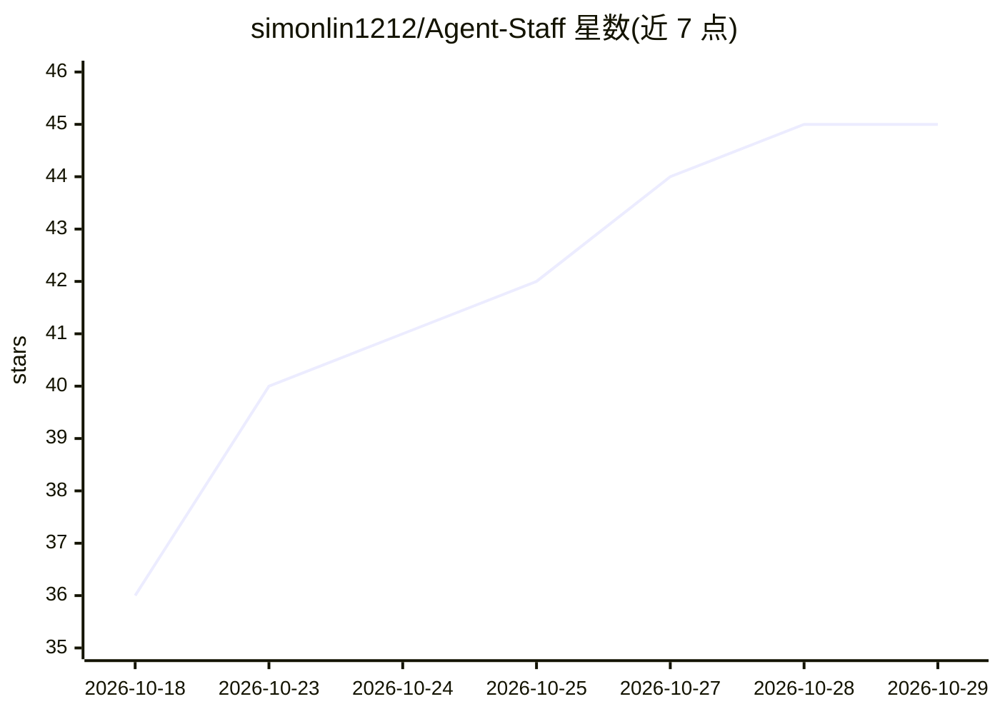

# simonlin1212/Agent-Staff

⭐ 45 · Python · MIT · 推送 2026-10-10 · [GitHub](https://github.com/simonlin1212/Agent-Staff) · 个人维护 · 中文 README

**按公司组织架构在飞书内为每个部门配 AI agent 的经营班子**

以飞书为入口、飞书多维表格为数据底座的多部门 agent 系统：按用户真实组织架构为业务/财务/人力/行政/运营/合规等部门各配一个 agent，CEO 参谋长 agent 跨部门聚合经营战报与损益。机制上每个部门 agent 只读自己的 Base（结构隔离），权限按飞书身份白名单控制；群内动嘴记账、cron 主动预警、读 PDF/OCR 文件、凭证挂靠。模型支持 Claude（作者实测）及 DeepSeek/Qwen/GLM/Ollama 等 OpenAI 兼容接口（多数理论支持未实测）。作者自述早期自用 dogfood 阶段。

## 筛选速览

| 维度 | 判定 | 备注 |
|---|---|---|
| AI 角色 | `ai-native` | 本体是模型或模型工具 |
| 许可风险 | `permissive` | MIT |
| 部署形态 | `library` | 以包/库形式分发 |
| 模型依赖 | local-ok | 支持本地模型 |
| 硬件要求 | — | 无带数字的原话,不猜 |
| 安装摩擦 | `low` | 无编译、无系统依赖或容器化 |
| 成熟度 | `idea` | |

## 能力要点

- 9 部门 agent 编制开箱即跑，可按组织架构增删部门
- 部门间结构隔离 + 飞书身份白名单权限墙
- 群内动嘴记账、跨部门经营战报、cron 主动预警
- 算数用 Python 代码、AI 只叙述，只报工具返回的真实数字

## 适用场景

- 让公司各部门台账记账、战报汇总由 AI 班子常驻处理
- 在飞书群里 @ 部门 agent 查损益、出经营战报
- 合同证照到期提醒与异常主动推群

## 场景标签

`多智能体` `AI 助手` · 领域:Agent 开发

## 证据(README 行号)

> L24: **按你公司真实的部门,给每个部门嵌一个 AI agent,再由一个 CEO 参谋长在上面统筹经营。** 你(真人 CEO)坐在最上面做决策,底下是一支 24 小时在线、各司其职、并行协作的 AI 班子——它们常驻**飞书**,以
> L86:  🏢 组织架构 Agent 化 按真实公司搭部门,每个部门一个 agent、各管一摊、并行; CEO 参谋长跨部门实时聚合经营
> L88:  📊 跨部门经营战报 每部门一个飞书多维表格当底座;读数 + <code>analyze</code> 出汇总战报,能下钻到明细。 想自动拉外部数据(行情 / 星数 / 流量)?写个 analyze 函数即可

## 星数曲线

2026-10-18 36 → 2026-10-29 45（+9）

---
*卡片 v1 · prompt 1.4 · 生成 2026-10-25 · 置信度 mid · 依据 README sha `971aa20bc900` · [字段定义](../../DATASET.md)*
