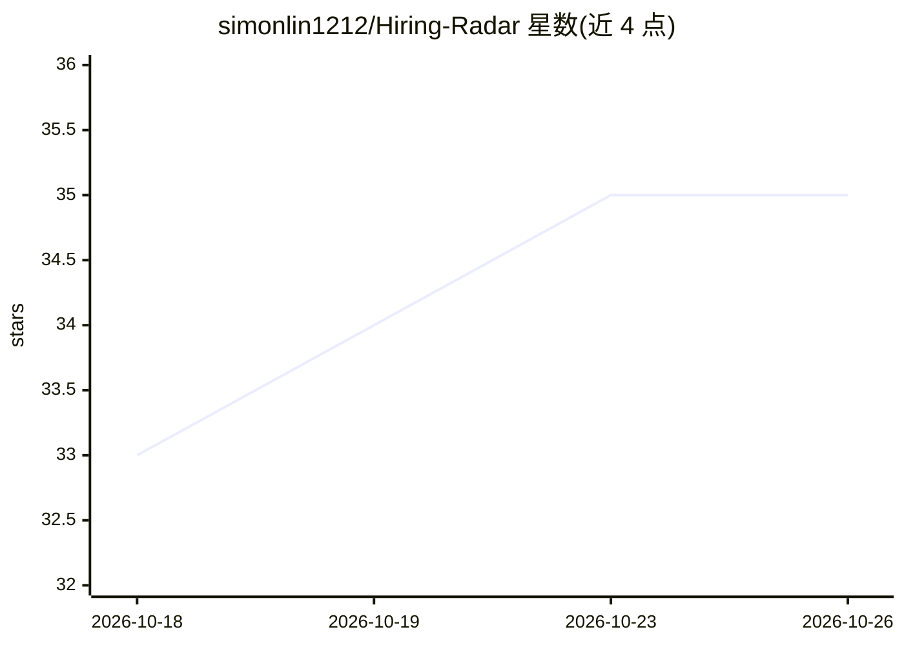

# simonlin1212/Hiring-Radar

⭐ 35 · Python · MIT · 推送 2026-10-12 · [GitHub](https://github.com/simonlin1212/Hiring-Radar) · 个人维护 · 中文 README

**供 AI 调用的全球招聘数据读取工具：查公司/市场在招岗位**

本地运行的 Python 命令行工具，读取公司招聘系统（ATS）与公开职位来源的无须登录接口，将在招岗位整理为统一字段的结构化数据。覆盖 24 个招聘系统、约 9 万家公司名录、12 个跨公司来源与中国 170 家公司（飞书/Moka/北森及大厂自建）。提供 MCP 服务（5 个工具），供 Claude Code / Codex 等直接调用。核心纯标准库，零账号零配置；只读公开岗位信息，不抓简历、不绕登录墙。

## 筛选速览

| 维度 | 判定 | 备注 |
|---|---|---|
| AI 角色 | `ai-ecosystem` | LLM/agent 周边工具 |
| 许可风险 | `permissive` | MIT |
| 部署形态 | `library` | 以包/库形式分发 |
| 模型依赖 | — | README 未给出锁定关系 |
| 硬件要求 | — | 无带数字的原话,不猜 |
| 安装摩擦 | `low` | 无编译、无系统依赖或容器化 |
| 成熟度 | — | 结构信号不足 |

## 能力要点

- 按公司名查询 24 个招聘系统（名录约 9 万家），或 --board 跨公司整片拉取
- 提供 MCP 服务，Claude Code / Codex 等 agent 可直接调用 5 个工具
- 输出 24 个统一字段的结构化数据，多来源去重、疑似中介标记、按发布时间分档
- 中国 170 家公司直查（飞书/Moka/北森解析 + 6 家大厂自建）；核心纯标准库零依赖

## 适用场景

- 查某个方向哪些公司在招、在哪个城市、薪资范围，用于求职
- 按国家/职能/时间整片拉取岗位数据做市场研究或找产品机会
- 定期存档并查看岗位新增/下架，作为产业与投资的领先信号参考
- 把招聘查询接入 Claude Code 等 agent 工作流

## 场景标签

`网页抓取` · 领域:效率与自动化

## 证据(README 行号)

> L27: **Hiring Radar 是一个面向 AI 的招聘数据工具——它让 AI（Claude Code / Codex / ChatGPT / 任意 agent）能直接读取全球 + 中国公司的官方在招岗位。** 它读公司自己的招聘系
> L51: |**M⁠C⁠P⁠ ⁠服⁠务**|`--mcp` 让 Claude Code / Codex 等直接调用（查公司、搜职位、查名录）|
> L83: claude mcp add hiring-radar -- python3 /path/to/Hiring-Radar/hiring_radar.py --mcp

## 星数曲线

2026-10-18 33 → 2026-10-26 35（+2）

---
*卡片 v1 · prompt 1.4 · 生成 2026-10-25 · 置信度 mid · 依据 README sha `59dc95f5f1b8` · [字段定义](../../DATASET.md)*
