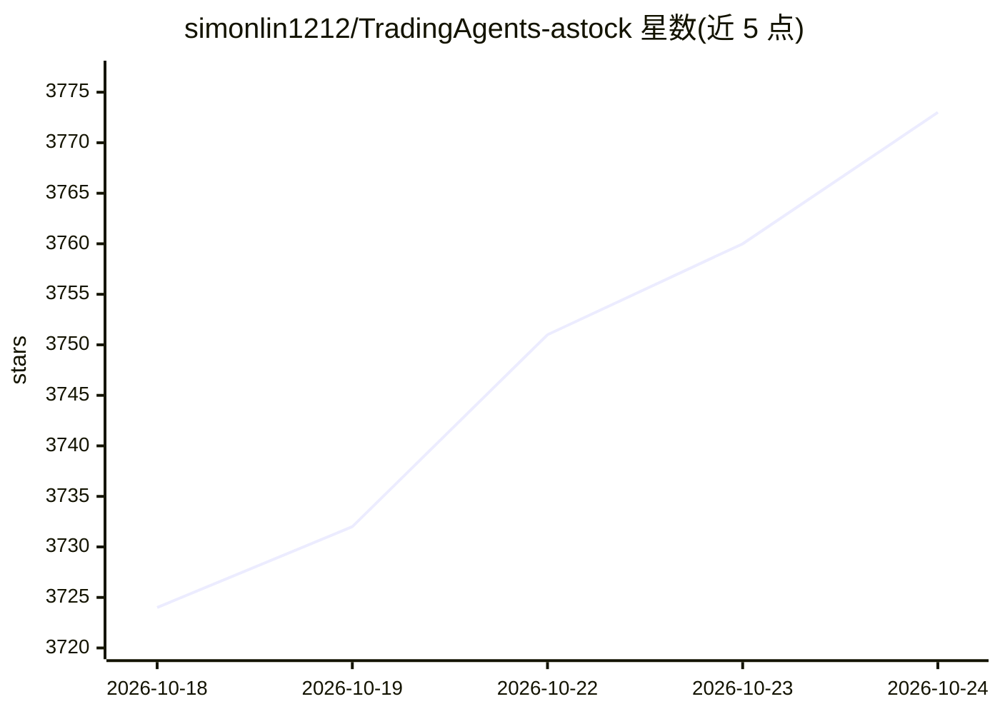

# simonlin1212/TradingAgents-astock

⭐ 3,773 · Python · Apache-2.0 · 推送 2026-10-11 · [GitHub](https://github.com/simonlin1212/TradingAgents-astock) · [官网](https://arxiv.org/pdf/2412.20138) · 个人维护 · 中文 README

**A股多Agent投研框架：7位AI分析师辩论生成投研报告**

基于 TauricResearch/TradingAgents 的 A 股特化 fork：多 Agent 辩论架构（7 个分析师 → 多空辩论 → 三方风控 → 决策），新增政策分析师、游资追踪、解禁监控三个 A 股角色；数据源走 mootdx、东财、新浪、同花顺等免费直连，无需 API Key，内置东财限流防封。交易规则适配 T+1、涨跌停、手数。提供 CLI 与 Streamlit Web UI，支持 10 家 LLM 供应商及 OpenAI 兼容网关、Ollama 本地运行，可分角色指定不同模型，支持订阅额度覆盖与绩效统计。面向研究与教学，不构成投资建议。

## 筛选速览

| 维度 | 判定 | 备注 |
|---|---|---|
| AI 角色 | `ai-native` | 本体是模型或模型工具 |
| 许可风险 | `permissive` | Apache-2.0 |
| 部署形态 | `self-host` | docker 或自建部署 |
| 模型依赖 | local-ok | 支持本地模型 |
| 硬件要求 | — | 无带数字的原话,不猜 |
| 安装摩擦 | `low` | 无编译、无系统依赖或容器化 |
| 成熟度 | — | 结构信号不足 |

## 能力要点

- 7 个分析师角色（含政策/游资/解禁三个 A 股特化角色）+ 多空辩论 + 三方风控的决策链
- 免费数据源直连（mootdx/东财/新浪/同花顺等），无需 API Key，内置东财节流防封
- 支持 10 家 LLM 供应商、OpenAI 兼容网关与 Ollama，可分角色配置不同模型
- 决策绩效统计（方向正确率，对沪深 300 的 alpha 口径），零 LLM 调用

## 适用场景

- 输入 6 位 A 股代码一键生成含辩论与风控的投研报告
- 研究多 Agent 辩论架构在 A 股制度（T+1/涨跌停/龙虎榜）下的应用
- 用本地 Ollama 或多家厂商模型搭建自己的 A 股分析流程

## 场景标签

`多智能体` `金融量化` · 领域:Agent 开发

## 证据(README 行号)

> L5:  基于 TauricResearch/TradingAgents（65K ⭐）的 A 股深度特化 fork
> L37: |**Analyst 角色**|4 个（市场/情绪/新闻/基本面）|**7 个**（+政策分析师/游资追踪/解禁监控）|
> L84: 所有 7 个 Analyst 的报告会流入后续的 Bull/Bear 辩论和三方风险辩论，确保 A 股特色因素贯穿整条决策链。

## 星数曲线

2026-10-18 3,724 → 2026-10-24 3,773（+49）

---
*卡片 v1 · prompt 1.4 · 生成 2026-10-20 · 置信度 high · 依据 README sha `113c4a2ebb9f` · [字段定义](../../DATASET.md)*
