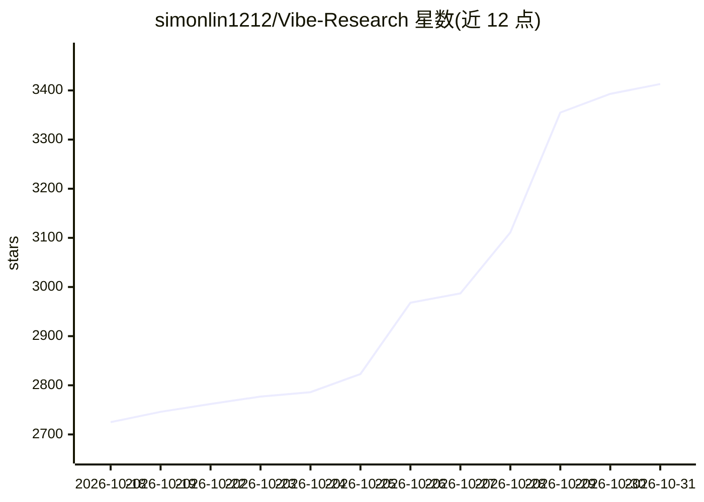

# simonlin1212/Vibe-Research

⭐ 3,413 · TypeScript · MIT · 推送 2026-10-29 · [GitHub](https://github.com/simonlin1212/Vibe-Research) · [官网](https://viberesearch.wiki) · 个人维护 · 中文 README

**面向个人投资者的 A股/美股/港股本地投研工作台**

在本地运行的投资研究桌面应用：覆盖自选与持仓记账、每日复盘、产业资讯与 20 个板块的产业研究、六阶段个股深挖、多空辩论、自然语言回测、研报库等 8 个一级栏目，数据层提供 168 个端点（A 股/美股/港股行情、财务、公告、龙虎榜等）。AI 能力通过接入 Claude Code、Codex、WorkBuddy 订阅或任意 Chat Completions 兼容的模型 API（DeepSeek、通义千问、Kimi 等）获得，未接入时仍可浏览栏目与管理持仓；研究记录与资料保存在本机，含本地防篡改指纹登记簿。Windows/macOS/Linux 均可运行。

## 筛选速览

| 维度 | 判定 | 备注 |
|---|---|---|
| AI 角色 | `ai-enhanced` | 去掉 AI 部分产品仍成立 |
| 许可风险 | `permissive` | MIT |
| 部署形态 | `desktop` | 安装包/桌面程序 |
| 模型依赖 | locked-api |  |
| 硬件要求 | — | 无带数字的原话,不猜 |
| 安装摩擦 | `low` | 无编译、无系统依赖或容器化 |
| 成熟度 | — | 结构信号不足 |

## 能力要点

- 168 个数据端点覆盖 A 股/美股/港股行情、财务、公告、研报等
- 六阶段个股研究（画像→财务→盈利预期→估值→风险→报告），数字带证据编号
- 自然语言回测：43 项指标、稳健性检验与费用滑点对照，内置 4 种规则
- 支持接入 Claude Code/Codex/WorkBuddy 订阅或任意 Chat Completions 兼容 API，多家 Agent 研究过程可并排对比

## 适用场景

- 管理我的自选与持仓流水，看盈亏和持仓体检
- 让 AI 分阶段研究一家公司并生成带证据引用的报告
- 用自然语言描述想法在历史数据上跑回测
- 导入自己的研报 PDF 围绕资料提问并回查原文

## 场景标签

`金融量化` `文档问答` `数据分析` · 领域:效率与自动化

## 证据(README 行号)

> L24: Vibe Research 是一个 A 股、美股、港股的投研工作台。打开先看指数、自选和持仓盈亏，再复盘盘面、追资讯、研究产业和公司、验证想法，都在同一个页面里完成；研究记录和资料都保存在自己的电脑上。
> L97: 接入订阅或模型 API 后，AI 会按问题需要联网搜索、读取网页、取数和计算；解释概念、梳理思路、翻译这类不需要新数据的问题一般直接回答。完整研究要你确认后才启动，对话不会自动变成一轮研究。没接入 AI 时也可以先浏览各个栏目。
> L31: - **AI 用自己的**：Claude Code、Codex、WorkBuddy 订阅，或 DeepSeek、通义千问、Kimi、MiMo 等任意兼容 Chat Completions 的模型 API。

## 星数曲线

2026-10-18 2,725 → 2026-10-31 3,413（+688）

---
*卡片 v1 · prompt 1.4 · 生成 2026-10-21 · 置信度 mid · 依据 README sha `66a7b0489a9d` · [字段定义](../../DATASET.md)*
