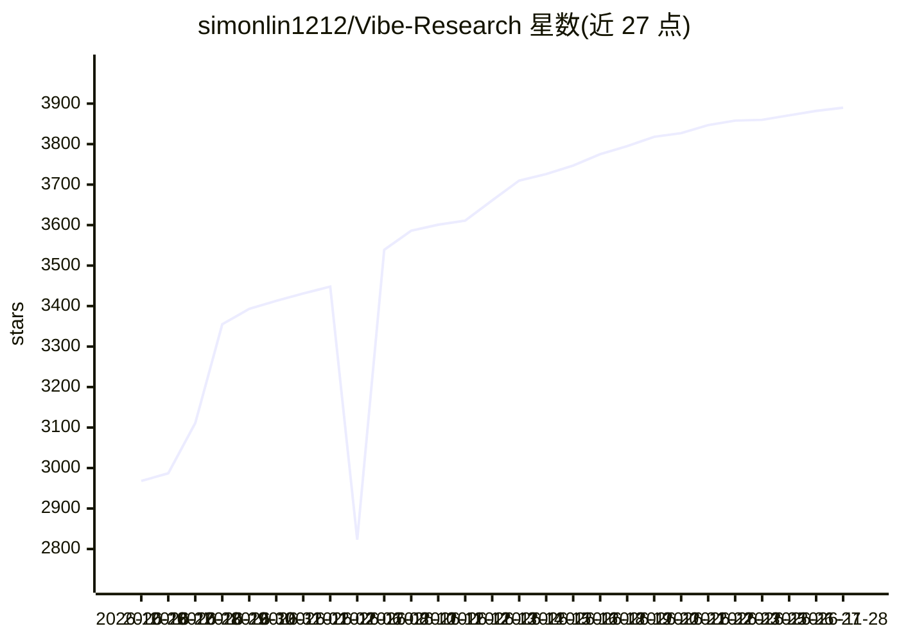

# simonlin1212/Vibe-Research

⭐ 3,890 · TypeScript · MIT · 推送 2026-11-12 · [GitHub](https://github.com/simonlin1212/Vibe-Research) · [官网](https://viberesearch.wiki) · 个人维护 · 中文 README

**A股/美股/港股投研工作台：AI 生成研究报告与回测**

本地运行的投研工作台，覆盖自选持仓记账、每日复盘、产业资讯与研究、个股六阶段深度研究、多空辩论、自然语言回测和可检索的研报库，共 168 个数据端点，数据和研究记录保存在本机。AI 接入方式为 Claude Code、Codex、WorkBuddy 订阅或任意兼容 Chat Completions 的模型 API；回答列出取数来源，报告中的数字经出处核对，无出处的数字标记后才能交付。不能下单交易。

## 筛选速览

| 维度 | 判定 | 备注 |
|---|---|---|
| AI 角色 | `ai-native` | 本体是模型或模型工具 |
| 许可风险 | `permissive` | MIT |
| 部署形态 | `desktop` | 安装包/桌面程序 |
| 模型依赖 | — | README 未给出锁定关系 |
| 硬件要求 | — | 无带数字的原话,不猜 |
| 安装摩擦 | `low` | 无编译、无系统依赖或容器化 |
| 成熟度 | — | 结构信号不足 |

## 能力要点

- 168 个数据端点覆盖 A 股、美股、港股行情、财务、公告、资金等 35 层
- 六阶段个股研究报告，每个数字带证据或计算编号，可信度分档标注
- 对话式回测：43 项指标、内置四种规则、与指数对照出图
- 支持 Claude Code/Codex/WorkBuddy 订阅或任意 Chat Completions 兼容模型 API

## 适用场景

- 对 A 股、港股、美股个股做分阶段深挖并生成带证据的研究报告
- 用自然语言描述策略，跑历史回测并与指数对照
- 记录交易流水、做持仓体检和历史大跌期回放
- 导入研报 PDF 并围绕资料提问、核对引用原文

## 场景标签

`金融量化` · 领域:学习与行业

## 证据(README 行号)

> L24: Vibe Research 是一个 A 股、美股、港股的投研工作台。打开先看指数、自选和持仓盈亏，再复盘盘面、追资讯、研究产业和公司、验证想法，都在同一个页面里完成；研究记录和资料都保存在自己的电脑上。
> L31: - **AI 用自己的**：Claude Code、Codex、WorkBuddy 订阅，或 DeepSeek、通义千问、Kimi、MiMo 等任意兼容 Chat Completions 的模型 API。
> L138: 报告「推断」里每条标一档可信度：已披露证实 / 有依据的推断 / 未核实线索 / 被反证，除「未核实线索」外都要写出证据或计算编号。报告开头附「口径提示」：同一计算混用了币种、TTM 与单季计算的期末不一致、按 A 股定期报告披

## 星数曲线

2026-10-26 2,968 → 2026-11-28 3,890（+922）

---
*卡片 v1 · prompt 1.4 · 生成 2026-11-23 · 置信度 mid · 依据 README sha `1eaab7df7590` · [字段定义](../../DATASET.md)*
