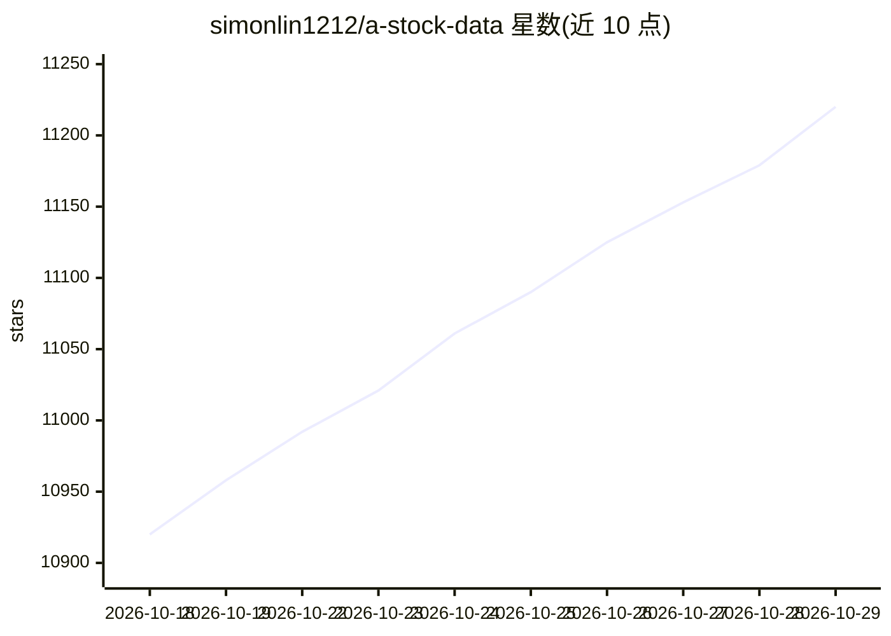

# simonlin1212/a-stock-data

⭐ 11,220 · Python · Apache-2.0 · 推送 2026-10-28 · [GitHub](https://github.com/simonlin1212/a-stock-data) · 个人维护 · 中文 README

**给 AI 编程助手的 A 股全栈数据 Skill：87 端点免 Key**

一个自包含的 SKILL.md 文件（结构化 Markdown + 内嵌 Python），把 34 个数据源的 A 股及相关市场数据封装成 AI 编程助手可直接调用的工具集，覆盖 15 层、87 个端点：行情 K 线、逐笔、研报、资金面、新闻、财务、公告、打板、ETF 期权、宏观利率、期货、事件驱动、可转债等。除 iwencai 外全部数据源无需 API Key；附主源→备胎降级策略，按封 IP 风险排定来源优先级。安装方式为拷贝 SKILL.md 到 Claude Code 技能目录，兼容 Codex/OpenClaw 等支持上下文注入的助手。

## 筛选速览

| 维度 | 判定 | 备注 |
|---|---|---|
| AI 角色 | `ai-ecosystem` | LLM/agent 周边工具 |
| 许可风险 | `permissive` | Apache-2.0 |
| 部署形态 | `library` | 以包/库形式分发 |
| 模型依赖 | — | README 未给出锁定关系 |
| 硬件要求 | — | 无带数字的原话,不猜 |
| 安装摩擦 | `low` | 无编译、无系统依赖或容器化 |
| 成熟度 | — | 结构信号不足 |

## 能力要点

- 15 层 · 87 个端点 · 34 个数据源，除 iwencai 外零鉴权
- 兼容 Claude Code / Codex / OpenClaw 等支持上下文注入的助手
- 主源被封时按「备用源速查」降级，来源按封 IP 风险分级
- 内置单票估值、批量对比、主题研报、新标的调研 4 套流程

## 适用场景

- 让 AI 助手直接拉取个股估值、K 线、资金流向与龙虎榜数据
- 做 A 股个股或行业调研时自动汇总研报、公告与财务数据
- 查询宏观利率、期货持仓、可转债等市场数据

## 场景标签

`金融量化` `网页抓取` · 领域:效率与自动化

## 证据(README 行号)

> L27: 一个自包含的 Skill 文件，把分散在 34 个数据源里的 A 股及相关市场原始数据整合成 AI 编程助手直接能用的工具集。你不用再背腾讯 K 线的分段参数、通达信盘后包的二进制格式、东财的 PDF Referer 头、iwen
> L29: > 兼容 Claude Code · Codex · OpenClaw · WorkBuddy · Muse · Grok Bot
> L31: > Skill 文件本质是结构化 Markdown + 内嵌 Python，任何支持上下文注入的 AI 编程助手都能用。

## 星数曲线

2026-10-18 10,920 → 2026-10-29 11,220（+300）

---
*卡片 v1 · prompt 1.4 · 生成 2026-10-20 · 置信度 mid · 依据 README sha `e148a37955a0` · [字段定义](../../DATASET.md)*
