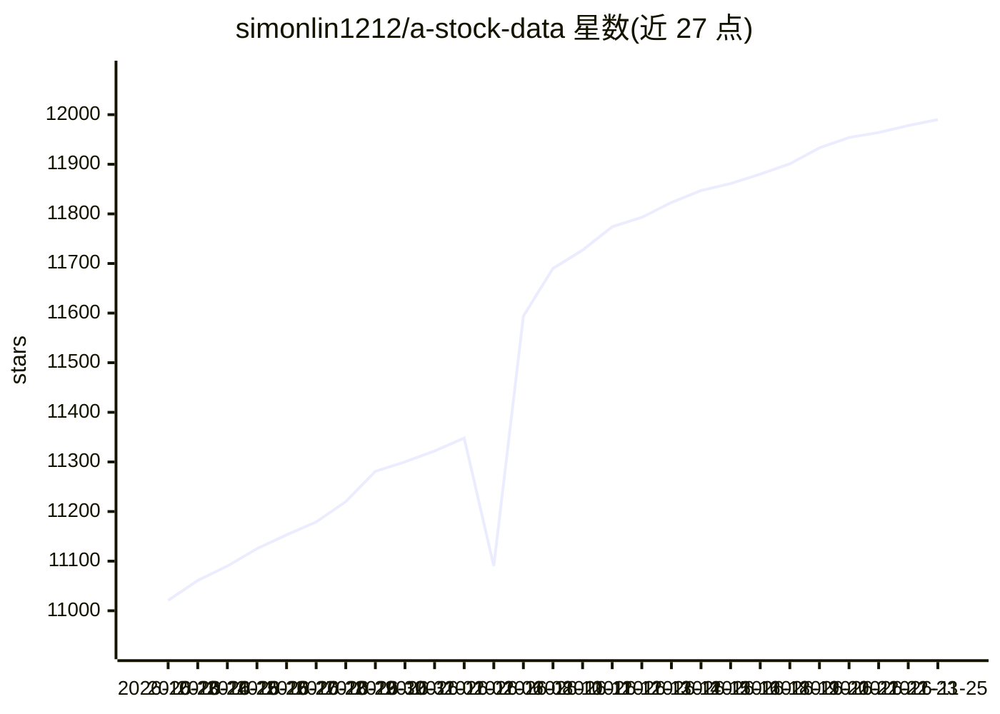

# simonlin1212/a-stock-data

⭐ 11,990 · Python · Apache-2.0 · 推送 2026-11-03 · [GitHub](https://github.com/simonlin1212/a-stock-data) · 个人维护 · 中文 README

**给 AI 编程助手的 A 股数据技能包：87 端点直连 34 个数据源**

一个自包含的 SKILL.md（结构化 Markdown + 内嵌 Python），把腾讯、东财、新浪、巨潮、交易所官网等 34 个数据源的 A 股及相关市场数据访问封装成 AI 编程助手可直接调用的工具集，覆盖行情 K 线、逐笔、研报、资金面、财务、公告、打板、ETF 期权、宏观利率、期货、可转债等 15 类 87 个端点。除 iwencai 需 API Key 外免鉴权；含主源被封时的备用源降级策略与 4 套内置调研流程。安装方式为将 SKILL.md 放入 Claude Code 的 skill 目录，其他助手贴入上下文即可。

## 筛选速览

| 维度 | 判定 | 备注 |
|---|---|---|
| AI 角色 | `ai-ecosystem` | LLM/agent 周边工具 |
| 许可风险 | `permissive` | Apache-2.0 |
| 部署形态 | `library` | 以包/库形式分发 |
| 模型依赖 | — | README 未给出锁定关系 |
| 硬件要求 | — | 无带数字的原话,不猜 |
| 安装摩擦 | `low` | 无编译、无系统依赖或容器化 |
| 成熟度 | — | 结构信号不足 |

## 能力要点

- 15 层架构 · 87 个端点 · 34 个数据源，除 iwencai 外免 API Key
- 兼容 Claude Code / Codex / OpenClaw 等支持上下文注入的 AI 编程助手
- 备用源速查与降级策略，主源被封时可切换
- 内置 4 套调研流程（单票估值/批量对比/主题研报/新标的调研）

## 适用场景

- 在 Claude Code 里直接问「帮我看看某只股票的估值」自动取数
- 检索某产业链最近的研报与评级
- 查涨停打板、龙虎榜、北向资金等盘面数据
- 查社融、PMI、利率曲线等宏观指标

## 场景标签

`金融量化` · 领域:学习与行业

## 证据(README 行号)

> L27: 一个自包含的 Skill 文件，把分散在 34 个数据源里的 A 股及相关市场原始数据整合成 AI 编程助手直接能用的工具集。你不用再背腾讯 K 线的分段参数、通达信盘后包的二进制格式、东财的 PDF Referer 头、iwen
> L29: > 兼容 Claude Code · Codex · OpenClaw · WorkBuddy · Muse · Grok Bot
> L89: 启动 Claude Code，说一句「帮我看看 688017 的估值」，自动激活。

## 星数曲线

2026-10-23 11,021 → 2026-11-25 11,990（+969）

---
*卡片 v1 · prompt 1.4 · 生成 2026-11-22 · 置信度 mid · 依据 README sha `84a5a511e001` · [字段定义](../../DATASET.md)*
