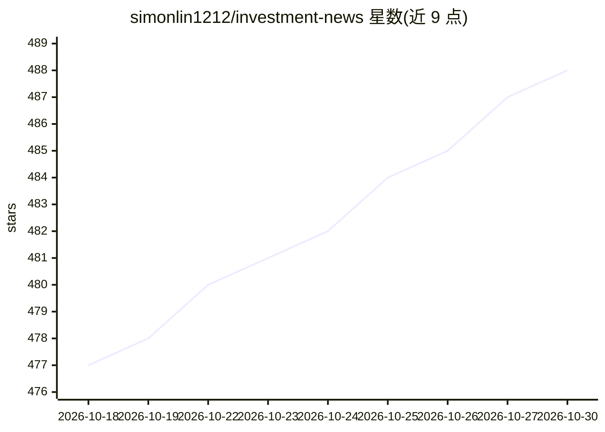

# simonlin1212/investment-news

⭐ 488 · JavaScript · MIT · 推送 2026-10-27 · [GitHub](https://github.com/simonlin1212/investment-news) · 个人维护 · 中文 README

**给A股投资者的本地 AI 产业链资讯看板，每日中文要点提炼**

本地运行的浏览器看板：从 108 个 RSS/接口源抓取 12 个赛道（对应 A股板块）的全球资讯，经合规过滤与时间去重后，调用用户自己的大模型（本机 Claude Code 订阅或任意 OpenAI 兼容 API）每日提炼为每赛道 3–5 条中文「今日要点」并翻译英文标题，每条附原文链接。纯 Python 标准库实现，无第三方依赖、无数据库、无托管，git clone 后运行本地服务访问 localhost:8793。声明不构成投资建议。

## 筛选速览

| 维度 | 判定 | 备注 |
|---|---|---|
| AI 角色 | `ai-native` | 本体是模型或模型工具 |
| 许可风险 | `permissive` | MIT |
| 部署形态 | `None` |  |
| 模型依赖 | locked-api |  |
| 硬件要求 | — | 无带数字的原话,不猜 |
| 安装摩擦 | `low` | 无编译、无系统依赖或容器化 |
| 成熟度 | — | 结构信号不足 |

## 能力要点

- 108 源 / 12 赛道，每赛道置顶 3–5 条 AI 生成的中文今日要点
- 引擎双选：本机 claude-cli 订阅（$0）或任意 OpenAI 兼容 API，单配置切换
- 纯 Python 标准库，零第三方依赖，数据全程留存本机
- sources.json 加一行即可新增信息源，看板内一键刷新

## 适用场景

- 跟踪半导体、AI、新能源车等 A股板块对应的全球先行信号并汇总为一屏中文要点
- 无需英文阅读能力即可掌握海外行业动向，并可下钻原文核实
- 同时关注多个投资赛道、希望减少信息过载的日常浏览

## 场景标签

`金融量化` `网页抓取` · 领域:效率与自动化

## 证据(README 行号)

> L25: **Investment News 是为 A股投资者打造的全球产业链资讯看板。** 半导体、AI、机器人、新能源车、航天…这 12 大赛道一一对应 A股板块，而真正驱动板块的领先信号，往往先出现在全球英文源里。本工具覆盖全球 10
> L41: |**今⁠日⁠要⁠点**|每个赛道置顶 3–5 条中文要点，跨源聚合去重、提炼核心公司与数据，由本地大模型生成|

## 星数曲线

2026-10-18 477 → 2026-10-30 488（+11）

---
*卡片 v1 · prompt 1.4 · 生成 2026-10-21 · 置信度 high · 依据 README sha `380e55de67a8` · [字段定义](../../DATASET.md)*
