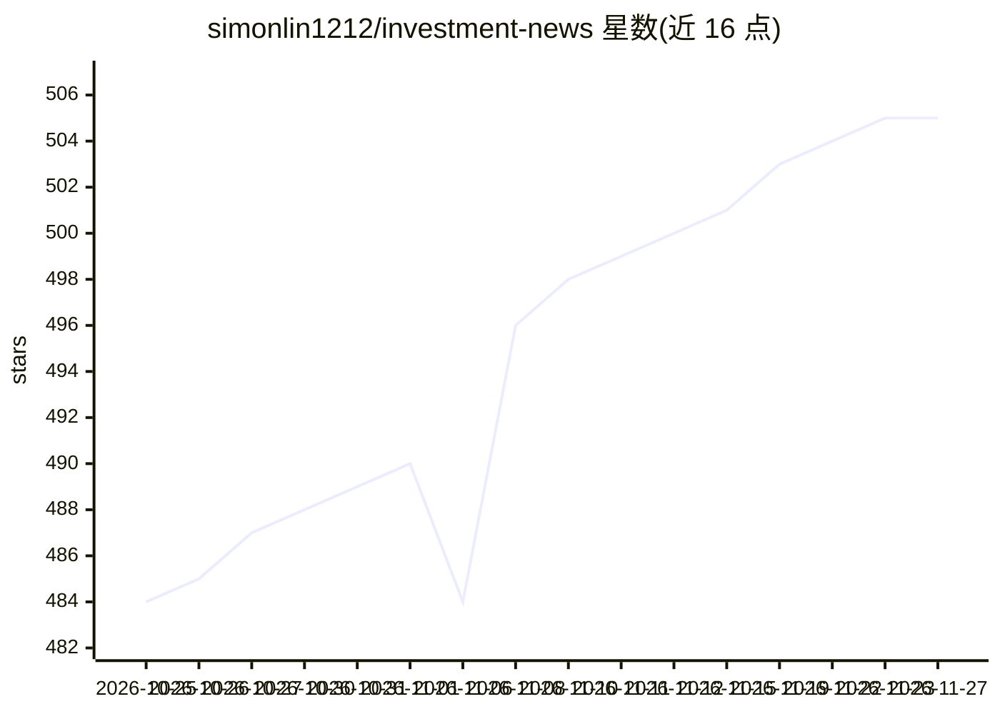

# simonlin1212/investment-news

⭐ 505 · JavaScript · MIT · 推送 2026-10-27 · [GitHub](https://github.com/simonlin1212/investment-news) · 个人维护 · 中文 README

**给A股投资者：AI 每日提炼 12 赛道全球资讯为中文要点**

本地运行的资讯看板，将 106 个英文/中文信息源按 12 条赛道（对应A股板块）聚合，调用用户自己的大模型生成每赛道 3–5 条中文「今日要点」并翻译英文标题，每条要点附原文链接溯源。抓取与呈现基于纯 Python 标准库，无第三方依赖、无数据库、无托管服务；大模型可选本机 Claude Code 订阅（claude-cli）或任意 OpenAI 兼容 API。README 明确声明呈现行业动向而非行情数据，不构成投资建议。

## 筛选速览

| 维度 | 判定 | 备注 |
|---|---|---|
| AI 角色 | `ai-native` | 本体是模型或模型工具 |
| 许可风险 | `permissive` | MIT |
| 部署形态 | `None` |  |
| 模型依赖 | locked-api |  |
| 硬件要求 | — | 无带数字的原话,不猜 |
| 安装摩擦 | `low` | 无编译、无系统依赖或容器化 |
| 成熟度 | — | 结构信号不足 |

## 能力要点

- 12 赛道聚合 106 个信息源，每赛道 AI 提炼 3–5 条中文要点并去重
- 双引擎接入：本机 Claude Code 订阅（claude-cli，$0）或任意 OpenAI 兼容 API
- 纯 Python 3.7+ 标准库实现，零第三方依赖，仅本地运行
- 每条要点附原文链接溯源，内置合规关键词过滤

## 适用场景

- 跟踪半导体、AI、新能源车等A股板块的全球先行信号
- 不用英文阅读能力即可掌握海外科技媒体当日要点
- 本地增删信息源，自定义赛道资讯流

## 场景标签

`金融量化` · 领域:学习与行业

## 证据(README 行号)

> L25: **Investment News 是为 A股投资者打造的全球产业链资讯看板。** 半导体、AI、机器人、新能源车、航天…这 12 大赛道一一对应 A股板块，而真正驱动板块的领先信号，往往先出现在全球英文源里。本工具覆盖全球 10
> L46: |**引⁠擎⁠双⁠选**|支持本机 Claude 订阅（`claude-cli`，$0）与任意 OpenAI 兼容 API 两种接入，单一配置项切换|

## 星数曲线

2026-10-25 484 → 2026-11-27 505（+21）

---
*卡片 v1 · prompt 1.4 · 生成 2026-11-25 · 置信度 high · 依据 README sha `5a62b090ad57` · [字段定义](../../DATASET.md)*
