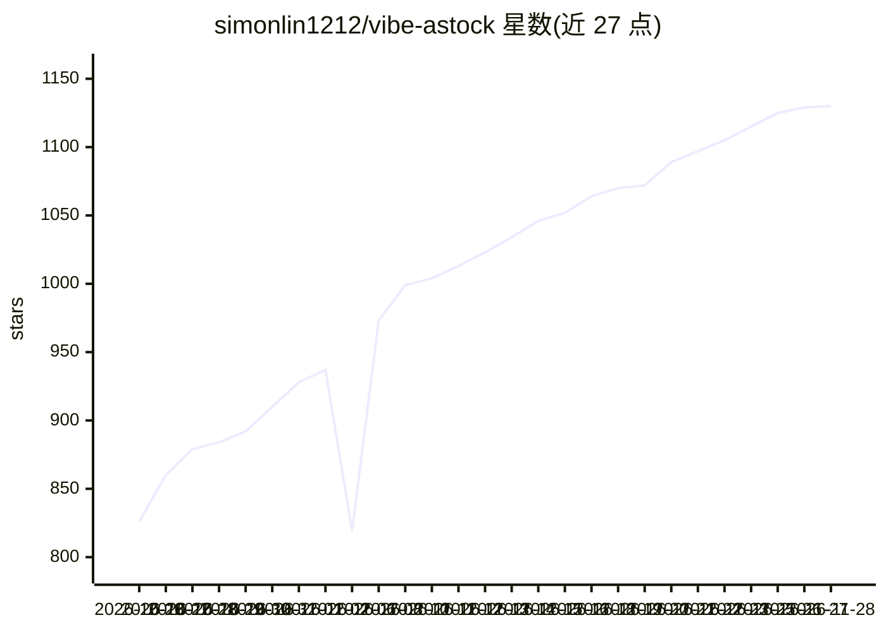

# simonlin1212/vibe-astock

⭐ 1,130 · TypeScript · Apache-2.0 · 推送 2026-11-12 · [GitHub](https://github.com/simonlin1212/vibe-astock) · 个人维护 · 中文 README

**A 股短线复盘与跟踪工作台：盯盘、情绪复盘与 AI 复盘**

面向 A 股短线交易者的本地复盘与跟踪工作台，覆盖盯盘异动、情绪复盘（连板天梯、题材轮动、明日验证）、交易日志、盘前提醒等 10 个栏目，含 182 个数据端点。AI 部分通过接入 Claude Code、Codex、WorkBuddy 订阅或任意兼容 Chat Completions 的模型 API 实现五段式 AI 复盘与 AI 周报，每个数字由程序核对出处；行情和统计由程序计算，AI 只负责解读。数据与记录存于本机，交易日志不发给 AI。支持 Windows/macOS/Linux 及云端远程访问。

## 筛选速览

| 维度 | 判定 | 备注 |
|---|---|---|
| AI 角色 | `ai-native` | 本体是模型或模型工具 |
| 许可风险 | `permissive` | Apache-2.0 |
| 部署形态 | `desktop` | 安装包/桌面程序 |
| 模型依赖 | — | README 未给出锁定关系 |
| 硬件要求 | — | 无带数字的原话,不猜 |
| 安装摩擦 | `low` | 无编译、无系统依赖或容器化 |
| 成熟度 | — | 结构信号不足 |

## 能力要点

- 五段式 AI 复盘与 AI 周报，每个数字由程序分档核对出处
- 182 个数据端点（35 层），其中 14 个短线专用
- 明日验证：收盘后写条件，下一交易日自动对账
- 支持 Claude Code、Codex、WorkBuddy 订阅或任意 Chat Completions 兼容模型 API

## 适用场景

- 盘中跟踪持仓与自选股的急拉急跌、封板开板异动
- 收盘后让 AI 按情绪、资金、题材分五段写复盘并核对数字出处
- 记录每笔交易并按入场日情绪环境分组回看胜率
- 盘前接收隔夜外围与公告停复牌提醒

## 场景标签

`金融量化` · 领域:学习与行业

## 证据(README 行号)

> L24: Vibe AStock 是一个 A 股短线复盘与跟踪工作台。盘中在「盯盘」看持仓、自选和昨日梯队的异动；收盘后在「情绪复盘」看情绪读数，让 AI 分情绪、资金、题材、龙虎榜、龙头五段写复盘，写下明天要验证的条件，下一个交易日收盘自
> L34: - **AI 用自己的**：Claude Code、Codex、WorkBuddy 订阅，或 DeepSeek、通义千问、Kimi、MiMo 等任意兼容 Chat Completions 的模型 API。
> L132: - **AI 复盘**：情绪、资金、题材、龙虎榜、龙头五段，每段开一个新对话、只看自己那几块数据，最后写汇总并建议明日验证条件，一键加进「明日验证」。每个数字由程序分三档核对：对得上资料包、写了算式且重算通过、没交代出处（算式对

## 星数曲线

2026-10-26 826 → 2026-11-28 1,130（+304）

---
*卡片 v1 · prompt 1.4 · 生成 2026-11-24 · 置信度 high · 依据 README sha `de4ee75032c8` · [字段定义](../../DATASET.md)*
