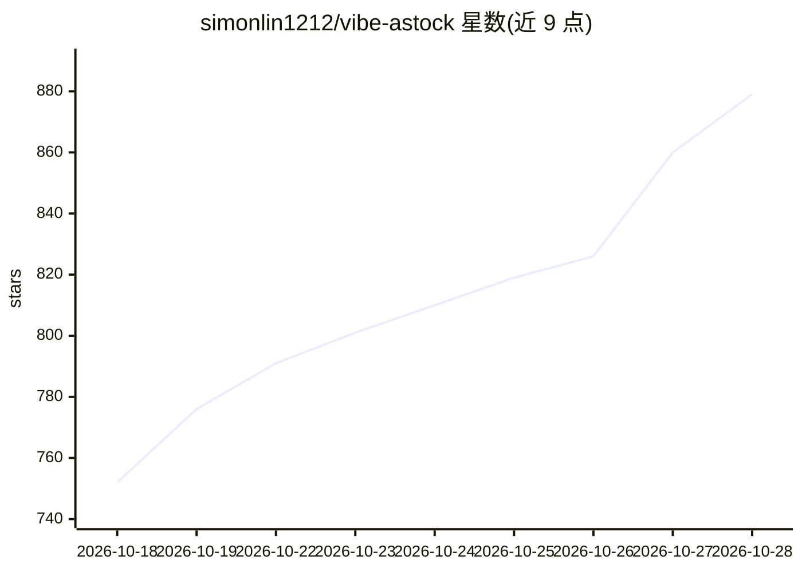

# simonlin1212/vibe-astock

⭐ 884 · TypeScript · Apache-2.0 · 推送 2026-10-26 · [GitHub](https://github.com/simonlin1212/vibe-astock) · 个人维护 · 中文 README

**A 股短线复盘与跟踪工作台，带 AI 复盘与数字溯源**

面向 A 股短线交易者的本地复盘工作台：盘中盯盘（持仓/自选/昨日梯队异动、竞价与六个时点情绪路径）、收盘后情绪复盘（连板天梯、晋级率、题材轮动、封板质量）、明日验证（写条件次日自动对账）、交易日志（按情绪与板位分组看胜率）、六阶段个股深挖、回测、盘前提醒，共 182 个数据端点。AI 部分接入 Claude Code、Codex、WorkBuddy 订阅或兼容 Chat Completions 的模型 API，行情和统计由程序计算，AI 只做解读，回答中每个数字由程序核对出处，交易日志只存本机不发给 AI。未接入 AI 也可浏览各栏目。

## 筛选速览

| 维度 | 判定 | 备注 |
|---|---|---|
| AI 角色 | `ai-enhanced` | 去掉 AI 部分产品仍成立 |
| 许可风险 | `permissive` | Apache-2.0 |
| 部署形态 | `desktop` | 安装包/桌面程序 |
| 模型依赖 | locked-api |  |
| 硬件要求 | — | 无带数字的原话,不猜 |
| 安装摩擦 | `low` | 无编译、无系统依赖或容器化 |
| 成熟度 | — | 结构信号不足 |

## 能力要点

- 182 个数据端点（35 层），含 14 个短线专用端点
- AI 复盘五段分写（情绪/资金/题材/龙虎榜/龙头），每个数字由程序分三档核对出处
- 明日验证：头晚写条件，下一交易日收盘自动对账并统计累计战绩
- 交易日志仅存本机、不发给 AI，按情绪环境/板位/打法分组看胜率

## 适用场景

- 短线交易者收盘后复盘情绪周期与题材轮动
- 盘中盯持仓与昨日涨停梯队的异动和竞价强弱
- 记录并自查自己的交易，按入场日情绪和板位分组看胜率
- 对 A 股、港股、美股做带证据编号的六阶段个股研究

## 场景标签

`金融量化` · 领域:学习与行业

## 证据(README 行号)

> L24: Vibe AStock 是一个 A 股短线复盘与跟踪工作台。盘中在「盯盘」看持仓、自选和昨日梯队的异动；收盘后在「情绪复盘」看情绪读数，让 AI 分情绪、资金、题材、龙虎榜、龙头五段写复盘，写下明天要验证的条件，下一个交易日收盘自

## 星数曲线

2026-10-18 752 → 2026-10-28 879（+127）

---
*卡片 v1 · prompt 1.4 · 生成 2026-10-21 · 置信度 low · 依据 README sha `be6d15f6e69a` · [字段定义](../../DATASET.md)*
