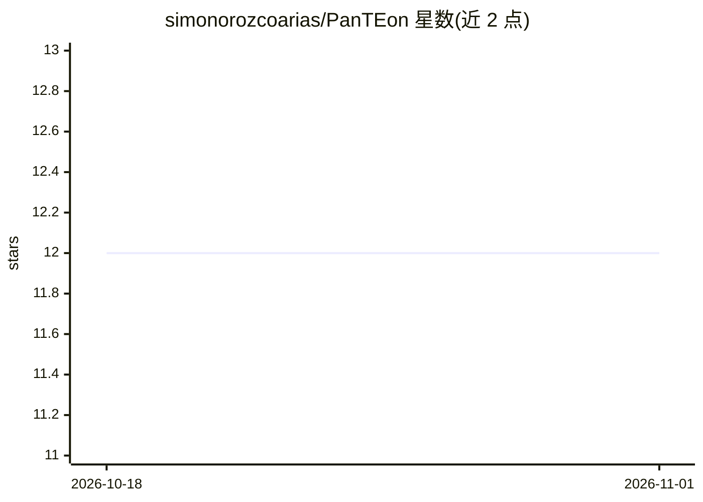

# simonorozcoarias/PanTEon

⭐ 12 · Python · GPL-3.0 · 推送 2026-08-18 · [GitHub](https://github.com/simonorozcoarias/PanTEon) · 个人维护

**转座子识别与注释的深度学习框架，附24万条TE数据库**

面向基因组学研究的转座子（TE）分析集成框架：内置训练模块（从FASTA训练多种ML/DL模型）、推理模块（最多九种架构并行分类与集成预测）、库构建模块（按分类层级/物种过滤生成定制TE库）与评估模块。配套约24万条自动注释TE数据库（Zenodo公开），内置BERTE、ClassifyTE、DeepTE等架构的统一基准测试。安装支持Apptainer/Singularity容器（推荐）、Conda环境文件与手动安装三种方式，CPU可运行但训练推荐GPU。

## 筛选速览

| 维度 | 判定 | 备注 |
|---|---|---|
| AI 角色 | `ai-native` | 本体是模型或模型工具 |
| 许可风险 | `viral` | GPL-3.0 |
| 部署形态 | `library` | 以包/库形式分发 |
| 模型依赖 | — | README 未给出锁定关系 |
| 硬件要求 | `cpu-ok` | |
| 安装摩擦 | `medium` | 含编译或系统依赖之一 |
| 成熟度 | — | 结构信号不足 |

## 能力要点

- 约24万条覆盖动物/植物/真菌的自动注释TE数据库（Zenodo公开）
- 训练/推理/库构建/评估四模块，最多九种架构并行推理与集成预测
- 内置9种TE分类架构与4种trimming架构的统一基准结果
- GPU与CPU双版本容器及Conda环境

## 适用场景

- 对基因组中的转座子做分类与注释
- 训练/对比自定义TE分类的深度学习模型
- 按物种与分类层级生成定制TE库以降低注释成本

## 场景标签

 · 领域:基因组学/生物信息学

## 证据(README 行号)

> L8: PanTEon is an integrated framework for the identification, curation, classification, and library construction of tra
> L27: * Training Module
> L33:  * Performs TE classification using one or multiple trained models (up to nine architectures in parallel)

## 星数曲线

2026-10-18 12 → 2026-11-01 12（+0）

---
*卡片 v1 · prompt 1.4 · 生成 2026-11-01 · 置信度 mid · 依据 README sha `bcd142175f9e` · [字段定义](../../DATASET.md)*
