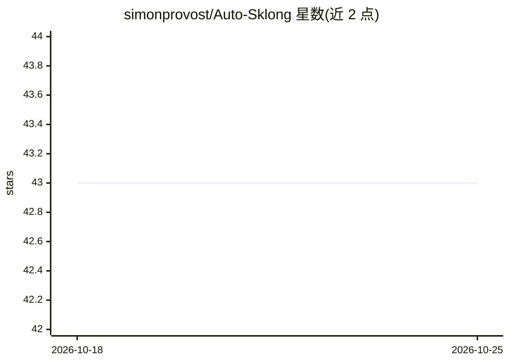

# simonprovost/Auto-Sklong

⭐ 43 · Python · Apache-2.0 · 推送 2026-03-20 · [GitHub](https://github.com/simonprovost/Auto-Sklong) · [官网](https://auto-sklong.readthedocs.io/en/latest/) · 个人维护

**面向纵向数据的 AutoML 分类库，研究者与开发者用**

基于 GAMA 框架与 Scikit-Longitudinal 构建的自动机器学习库：为纵向（重复测量）分类任务提供组合 Scikit-Longitudinal 与 Scikit-learn 模型的专用搜索空间，自动执行算法选择与超参数调优的组合优化。以 pip 包形式提供，支持 Python 3.9（受 Deep Forest 依赖限制），README 声明正在改造以支持 Python 3.10+、纵向感知后处理集成与多分类。附 BIBM 2024 论文引用条目。

## 筛选速览

| 维度 | 判定 | 备注 |
|---|---|---|
| AI 角色 | `ai-ecosystem` | LLM/agent 周边工具 |
| 许可风险 | `permissive` | Apache-2.0 |
| 部署形态 | `library` | 以包/库形式分发 |
| 模型依赖 | — | README 未给出锁定关系 |
| 硬件要求 | — | 无带数字的原话,不猜 |
| 安装摩擦 | `low` | 无编译、无系统依赖或容器化 |
| 成熟度 | `idea` | |

## 能力要点

- 组合 Scikit-Longitudinal 与 Scikit-learn 模型的纵向分类搜索空间
- 自动进行算法选择与超参数调优的组合优化
- pip 安装，附论文与文档入口

## 适用场景

- 对重复测量的纵向数据自动训练分类模型
- 科研场景下自动调参并复现论文方法
- 医疗随访类时序追踪数据的预测建模

## 场景标签

 · 领域:机器学习/AutoML

## 证据(README 行号)

> L38: `Auto-Sklong` is an Automated Machine Learning (AutoML) library developed on top of the
> L43: More specifically, `Auto-Sklong` is designed to perform combinatorial optimisation of both algorithm selection

## 星数曲线

2026-10-18 43 → 2026-10-25 43（+0）

---
*卡片 v1 · prompt 1.4 · 生成 2026-10-25 · 置信度 high · 依据 README sha `a09659af5069` · [字段定义](../../DATASET.md)*
