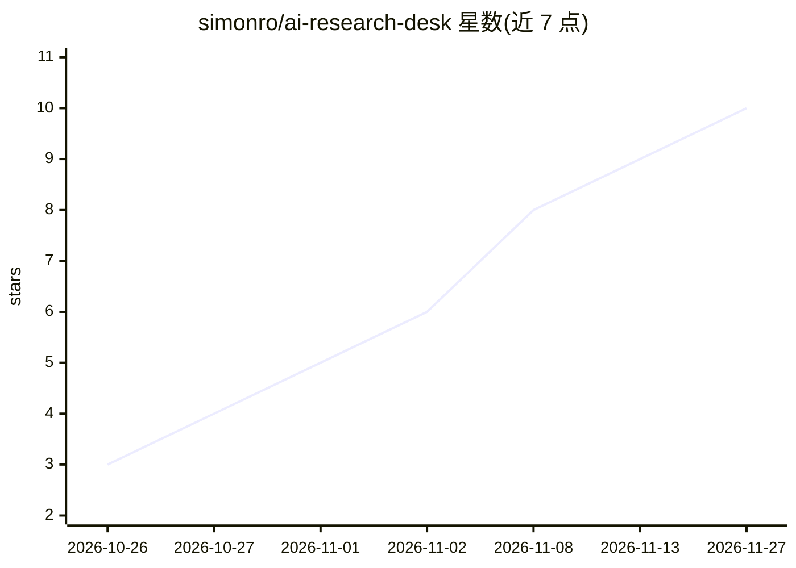

# simonro/ai-research-desk

⭐ 10 · Python · MIT · 推送 2026-11-09 · [GitHub](https://github.com/simonro/ai-research-desk) · [官网](https://www.youtube.com/@tapetoedge) · 个人维护

**个人股票研究工具：三个 AI 团队辩论一只股票，生成就地备忘录**

一个在本地运行的股票研究工作台：三个 AI 研究团队（两个改编自开源项目 TradingAgents 和 ai-hedge-fund，以及 Edge Desk）独立分析同一家公司，针对两个持有期（波段，2天至8周；长期，1年以上）进行对比，针对分歧进行辩论，并生成包含评级、操作建议、价格水平和理由的备忘录。模型调用通过用户现有的 Claude 或 ChatGPT 订阅计划（即 `claude` 或 `codex` CLI）进行，而非通过 API 账单计费。价格、估值和数据检查均由代码计算；数据过期或缺失时，系统会拒绝评级而非进行猜测。该工具仅限研究用途——不涉及订单下达或经纪商连接。需要 Python 3.12、git 和付费 AI 订阅计划。

## 筛选速览

| 维度 | 判定 | 备注 |
|---|---|---|
| AI 角色 | `ai-native` | 本体是模型或模型工具 |
| 许可风险 | `permissive` | MIT |
| 部署形态 | `library` | 以包/库形式分发 |
| 模型依赖 | — | README 未给出锁定关系 |
| 硬件要求 | — | 无带数字的原话,不猜 |
| 安装摩擦 | `low` | 无编译、无系统依赖或容器化 |
| 成熟度 | — | 结构信号不足 |

## 能力要点

- 三个 AI 研究团队分析同一股票，进行分歧辩论并生成备忘录
- 模型调用通过用户现有的 Claude/ChatGPT 订阅 CLI 进行，无需按次付费
- 价格水平和引用数据由代码计算和核对，而非由模型生成
- 运行记录、备忘录和 PDF 均保存在本地，无账户、无遥测、遵循 MIT 许可证

## 适用场景

- 为自己挑选的股票寻求多个 AI 观点的研究型投资者
- 希望在分析师团队备忘录中显示计算的价格水平而非模型自行生成
- 在本地保留研究运行记录和 PDF 以构建个人研究档案

## 场景标签

`多智能体` `金融量化` · 领域:Agent 开发

## 证据(README 行号)

> L7: A research desk for one stock at a time. Three AI research teams study the same company (two
> L13: - **It runs on your own AI plan, not an API bill.** Model calls go through your Claude plan (the
> L137: The desk has no API keys and no per-call bill. It sends every model call through the command-line

## 星数曲线

2026-10-26 3 → 2026-11-27 10（+7）

---
*卡片 v1 · prompt 1.4 · 生成 2026-11-20 · 置信度 mid · 依据 README sha `0030cb47b8e0` · [字段定义](../../DATASET.md)*
