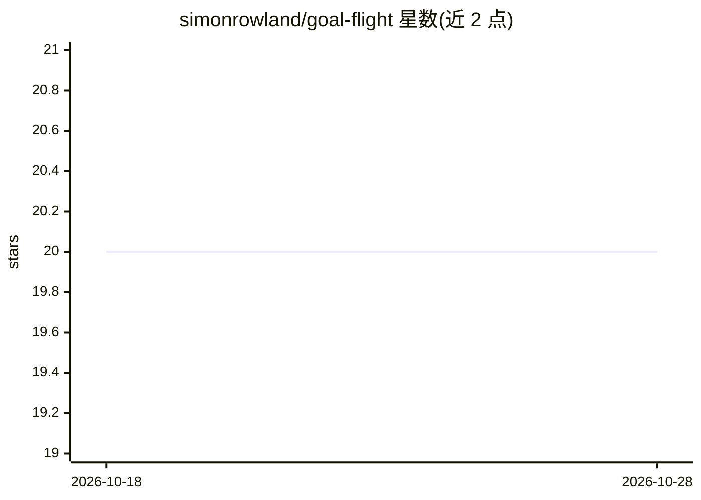

# simonrowland/goal-flight

⭐ 20 · Python · MIT · 推送 2026-10-28 · [GitHub](https://github.com/simonrowland/goal-flight) · 个人维护

**把 Claude Code 会话变成长时编码项目的多 agent 编排器**

以 Claude Code/Grok Bot 插件与脚本形式提供的长时任务控制器模式：收集需求、与用户确定架构后，把工作拆分为闭合 chunk 派发给 codex/grok/cursor/claude-cli 等 worker（本地或 SSH 远程），每个 worker 迭代 plan/act/test/review 循环，提交前经 7 类对抗自审与独立评审把关。运行状态存于持久项目文件以穿越压缩与重启，可选构建 RAG 语料供 worker 复用。git clone 安装到 Claude skills 目录，主平台 macOS，Windows 需 WSL。

## 筛选速览

| 维度 | 判定 | 备注 |
|---|---|---|
| AI 角色 | `ai-ecosystem` | LLM/agent 周边工具 |
| 许可风险 | `permissive` | MIT |
| 部署形态 | `None` |  |
| 模型依赖 | locked-api |  |
| 硬件要求 | — | 无带数字的原话,不猜 |
| 安装摩擦 | `low` | 无编译、无系统依赖或容器化 |
| 成熟度 | — | 结构信号不足 |

## 能力要点

- 把编码工作拆 chunk 派发给多个 worker agent（codex/grok/cursor/claude-cli）
- 每 chunk 经 7 类对抗自审与独立评审后才提交
- 持久化项目状态文件支持压缩/重启/隔夜无人值守后 resume
- 可选 RAG 语料库减少 worker 重复读取代码库

## 适用场景

- 长时间无人值守的软件项目编码，由多 agent 分工完成
- 把编码监督转为设计把控：我确认架构，worker 执行
- 跨多个编码 agent CLI 与远程 SSH 节点分派任务

## 场景标签

`多智能体` `编码 Agent` · 领域:Agent 开发

## 证据(README 行号)

> L10: goal-flight turns a Claude Code session into the **orchestrator** of a long-running
> L13: work to a range of coding agents: codex, grok, cursor, claude, running locally or on
> L20: **Hosts and workers.** Claude Code and Grok Bot are the

## 星数曲线

2026-10-18 20 → 2026-10-28 20（+0）

---
*卡片 v1 · prompt 1.4 · 生成 2026-10-28 · 置信度 high · 依据 README sha `20329200f744` · [字段定义](../../DATASET.md)*
