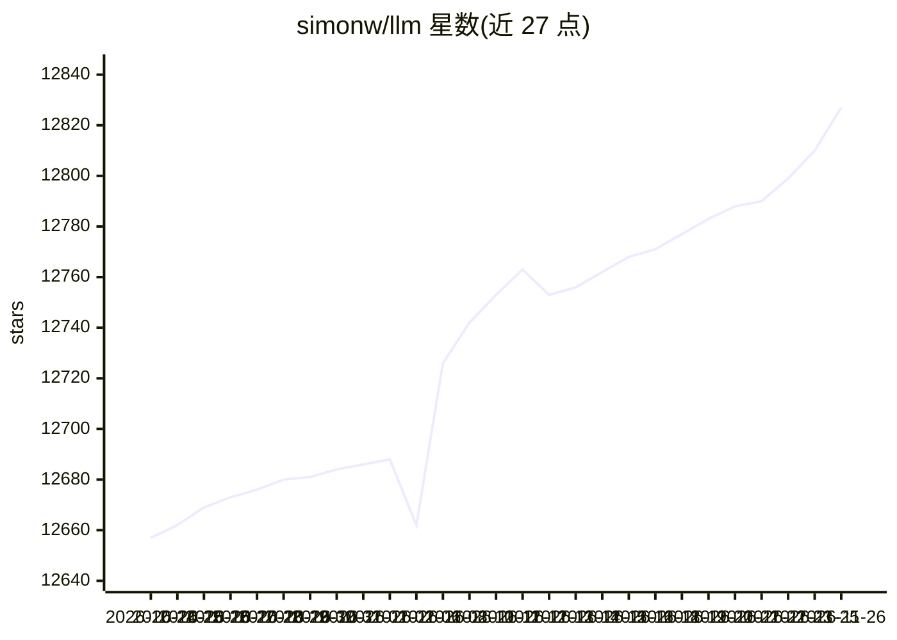

# simonw/llm

⭐ 12,827 · Python · Apache-2.0 · 推送 2026-11-25 · [GitHub](https://github.com/simonw/llm) · [官网](https://llm.datasette.io) · 个人维护

**开发者在命令行与 Python 中调用多家大语言模型的 CLI 工具**

LLM 是一个 CLI 工具兼 Python 库，用于从命令行运行 prompt、发起聊天、存储历史到 SQLite、生成与保存 embeddings、从文本和图像提取结构化内容，并允许模型执行工具。通过插件机制接入不同厂商 API 与本地模型，可对接任意 OpenAI 兼容端点（如 LM Studio）。提供 pip、Homebrew、pipx、uv 等安装方式，模型密钥通过 llm keys set 配置。

## 筛选速览

| 维度 | 判定 | 备注 |
|---|---|---|
| AI 角色 | `ai-ecosystem` | LLM/agent 周边工具 |
| 许可风险 | `permissive` | Apache-2.0 |
| 部署形态 | `library` | 以包/库形式分发 |
| 模型依赖 | local-ok | 支持本地模型 |
| 硬件要求 | — | 无带数字的原话,不猜 |
| 安装摩擦 | `low` | 无编译、无系统依赖或容器化 |
| 成熟度 | — | 结构信号不足 |

## 能力要点

- CLI 与 Python 库双形态，prompt 与对话结果可存入 SQLite
- 插件机制接入 Gemini、Anthropic、Ollama 本地模型等
- 支持 embeddings 生成、结构化内容提取与工具执行
- 可对任意 OpenAI 兼容 Chat Completions 端点发 prompt

## 适用场景

- 在终端直接向 GPT/Gemini/本地模型提问或对话
- 把模型响应持久化到 SQLite 供后续分析
- 为本机运行的模型生成 embeddings 做检索
- 让模型在终端中调用工具完成任务

## 场景标签

`模型网关` · 领域:Agent 开发

## 证据(README 行号)

> L11: A CLI tool and Python library for interacting with **OpenAI**, **Anthropic’s Claude**, **Google’s Gemini**, **Qwen*
> L15: With LLM you can:
> L26: First, install LLM using `pip` or Homebrew or `pipx` or `uv`:

## 星数曲线

2026-10-24 12,657 → 2026-11-26 12,827（+170）

---
*卡片 v1 · prompt 1.4 · 生成 2026-11-23 · 置信度 high · 依据 README sha `f88ead707ffd` · [字段定义](../../DATASET.md)*
