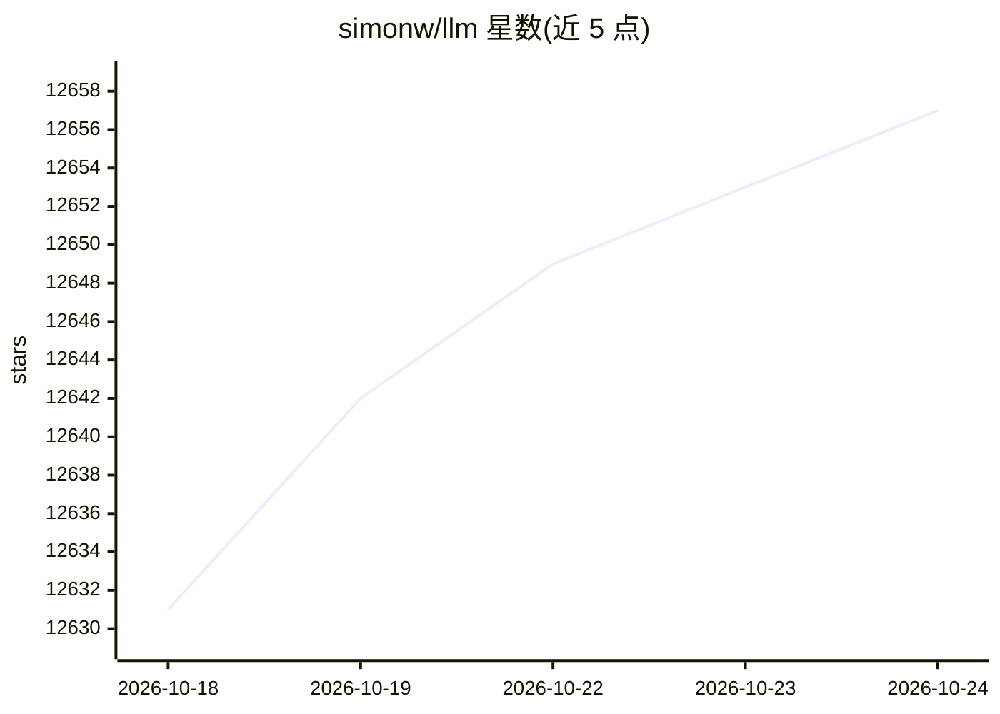

# simonw/llm

⭐ 12,657 · Python · Apache-2.0 · 推送 2026-10-21 · [GitHub](https://github.com/simonw/llm) · [官网](https://llm.datasette.io) · 个人维护

**命令行调用各类大模型的 CLI 工具与 Python 库**

LLM 是一个用于与大型语言模型交互的 CLI 工具和 Python 库，支持 OpenAI、Claude、Gemini、Qwen、DeepSeek 等数十种模型，可通过远程 API 或本机安装的模型运行。功能包括命令行执行 prompt、交互式聊天、将 prompt 与响应存入 SQLite、生成并存储 embeddings、从文本和图像提取结构化内容、为模型提供工具执行能力。安装方式为 pip/Homebrew/pipx/uv，通过插件机制扩展模型接入（如 llm-gemini、llm-ollama）。

## 筛选速览

| 维度 | 判定 | 备注 |
|---|---|---|
| AI 角色 | `ai-ecosystem` | LLM/agent 周边工具 |
| 许可风险 | `permissive` | Apache-2.0 |
| 部署形态 | `library` | 以包/库形式分发 |
| 模型依赖 | local-ok | 支持本地模型 |
| 硬件要求 | — | 无带数字的原话,不猜 |
| 安装摩擦 | `low` | 无编译、无系统依赖或容器化 |
| 成熟度 | — | 结构信号不足 |

## 能力要点

- 命令行运行 prompt 与交互式聊天
- prompt 与响应存储于 SQLite，支持 embeddings 存取
- 从文本和图像提取结构化内容（LLM schemas）
- 插件机制接入远程 API 与本地模型（Ollama 等）

## 适用场景

- 在终端直接调用各家大模型跑 prompt 或聊天
- 把 prompt/响应和嵌入记录进 SQLite 便于后续检索
- 用 schema 从非结构化文本和图像中抽取数据

## 场景标签

`模型网关` · 领域:Agent 开发

## 证据(README 行号)

> L11: A CLI tool and Python library for interacting with **OpenAI**, **Anthropic’s Claude**, **Google’s Gemini**, **Qwen*
> L15: With LLM you can:
> L26: First, install LLM using `pip` or Homebrew or `pipx` or `uv`:

## 星数曲线

2026-10-18 12,631 → 2026-10-24 12,657（+26）

---
*卡片 v1 · prompt 1.4 · 生成 2026-10-20 · 置信度 high · 依据 README sha `2ba553862d06` · [字段定义](../../DATASET.md)*
