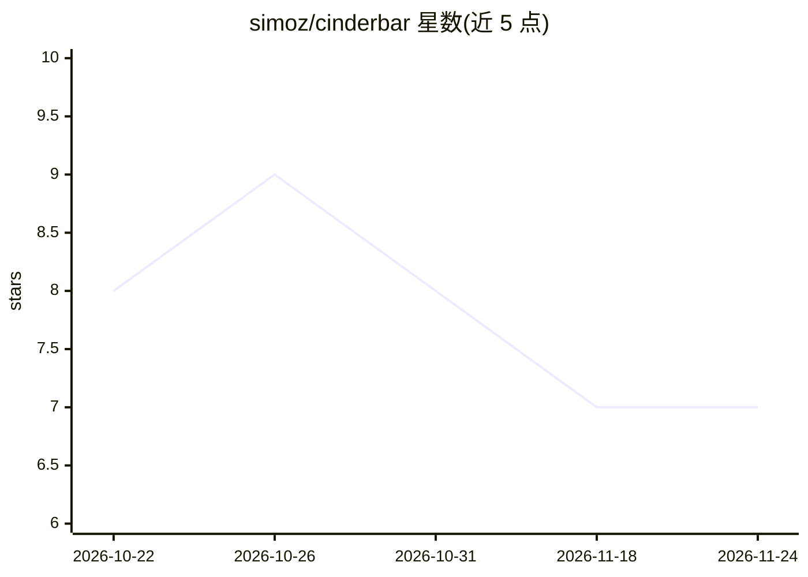

# simoz/cinderbar

⭐ 7 · Swift · NOASSERTION · 推送 2026-10-15 · [GitHub](https://github.com/simoz/cinderbar) · 个人维护

**macOS 菜单栏工具：显示 Claude/Codex/Grok 订阅的 token 消耗与用量节奏**

将 Burn Bar 移植为原生 Swift 菜单栏应用的 macOS 工具，面向同时付费多个 AI 订阅的用户。读取本机上 Claude Code、Codex、Grok 的本地会话记录（jsonl 文件）统计 token 消耗，以热力条展示用量，并给出订阅间切换建议：哪个订阅还有余量、哪个需要等待重置。通过非公开的 Anthropic 用量端点查询 Claude 限额（可关闭）。安装方式为 Releases 下载 zip 或从源码用脚本构建，需 macOS 14+。

## 筛选速览

| 维度 | 判定 | 备注 |
|---|---|---|
| AI 角色 | `ai-ecosystem` | LLM/agent 周边工具 |
| 许可风险 | `none` | NOASSERTION |
| 部署形态 | `desktop` | 安装包/桌面程序 |
| 模型依赖 | — | README 未给出锁定关系 |
| 硬件要求 | — | 无带数字的原话,不猜 |
| 安装摩擦 | `low` | 无编译、无系统依赖或容器化 |
| 成熟度 | — | 结构信号不足 |

## 能力要点

- 读取本地 Claude/Codex/Grok 会话文件统计 token 用量，含缓存读写的 token 构成
- 菜单栏热力条展示各订阅的消耗节奏与计划进度仪表
- 点击展开面板给出用量判定（ON TRACK/OVER 等）与切换建议、燃尽图与投影
- 增量扫描与缓存机制；隐私声明只保留数字与消息 id，不存消息文本

## 适用场景

- 同时订阅多个 AI 编码服务时决定当前用哪个
- 查看本周/5 小时窗口的用量进度与重置时间
- 长期记录 token 消耗并查看燃尽趋势

## 场景标签

 · 领域:开发者工具/用量监控

## 证据(README 行号)

> L11: A live thermal strip in the macOS menu bar for anyone paying for more than one
> L12: AI subscription. It reads what **this Mac actually uses** (Claude Code,
> L13: Codex and Grok), turns it into one heat map, and tells you **what to do**: which

## 星数曲线

2026-10-22 8 → 2026-11-24 7（-1）

---
*卡片 v1 · prompt 1.4 · 生成 2026-11-21 · 置信度 high · 依据 README sha `45027f87db3e` · [字段定义](../../DATASET.md)*
