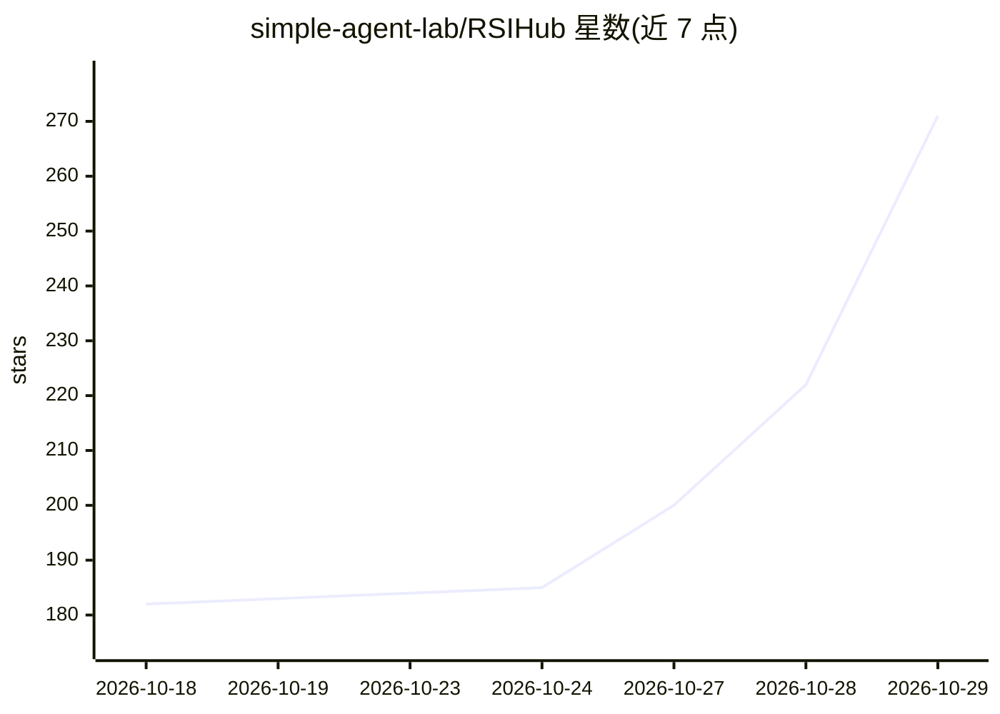

# simple-agent-lab/RSIHub

⭐ 271 · Python · Apache-2.0 · 推送 2026-10-27 · [GitHub](https://github.com/simple-agent-lab/RSIHub) · 组织维护 · 中文 README

**Agent 自我改进实验框架：冻结评测器下可审计的演化**

面向 agent 构建者与科研人员的文件式演化实验框架：让候选 agent 在固定评测器与声明的可变边界内自我改进（提示词、技能、harness、agent 代码）。核心机制是 select→rollout→analyze→mutate→guardrail→evaluate→absorb 循环，评测阶段由框架控制、不可被 recipe 选择，演化过程记录 Git 谱系与 archive.jsonl 以保证可复现审计；试验通过 Harbor 容器执行器运行。内置 hill_climb、aevolve、AHE、GEPA、Hyperagents 五种 recipe，附 Terminal-Bench 2.0 与 Tau³ Banking 基准结果。需 Python 3.12+，自称 active prototype。

## 筛选速览

| 维度 | 判定 | 备注 |
|---|---|---|
| AI 角色 | `ai-ecosystem` | LLM/agent 周边工具 |
| 许可风险 | `permissive` | Apache-2.0 |
| 部署形态 | `None` |  |
| 模型依赖 | — | README 未给出锁定关系 |
| 硬件要求 | — | 无带数字的原话,不猜 |
| 安装摩擦 | `low` | 无编译、无系统依赖或容器化 |
| 成熟度 | `idea` | |

## 能力要点

- 七阶段演化循环，评测与 guardrail 由框架控制、不可被 recipe 修改
- 每个候选连接分数、产物、档案记录与 Git 谱系，报告可重算
- 五种内置 recipe：hill_climb / aevolve / AHE / GEPA / Hyperagents
- 试验经 Harbor 容器执行器运行，含轨迹捕获与逐任务验证

## 适用场景

- 在固定评测器下改进 agent 的提示词与技能
- 对比不同演化策略在同一评测协议下的表现
- 追踪每次 agent 改动的来源与证据以满足审计需求

## 场景标签

`Agent 框架` `模型评测` · 领域:Agent 开发

## 证据(README 行号)

> L59: RSIHub gives an agent a controlled way to improve itself. It runs candidate
> L111: Evaluation is never a selectable operator — it stays framework-owned. See

## 星数曲线

2026-10-18 182 → 2026-10-29 271（+89）

---
*卡片 v1 · prompt 1.4 · 生成 2026-10-22 · 置信度 high · 依据 README sha `4f223fe7340d` · [字段定义](../../DATASET.md)*
