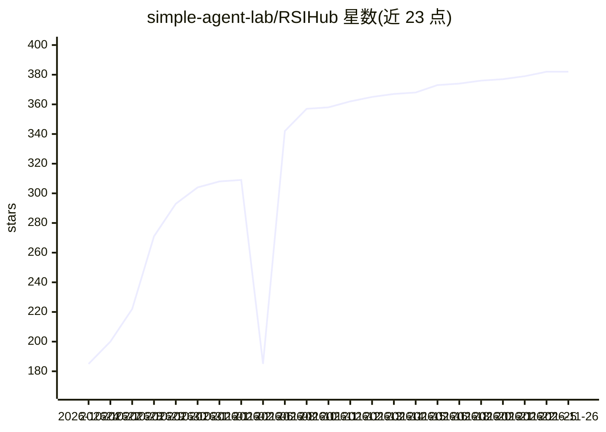

# simple-agent-lab/RSIHub

⭐ 382 · Python · Apache-2.0 · 推送 2026-10-27 · [GitHub](https://github.com/simple-agent-lab/RSIHub) · 组织维护 · 中文 README

**给 agent 研究者提供的自进化实验框架：冻结评测器下做可审计改进**

RSIHub 是一个文件式 agent 进化框架：在冻结评测器与声明式变异边界内，按 select→rollout→analyze→mutate→guardrail→evaluate→absorb 循环运行候选 agent，记录每次生成的改动谱系（archive.jsonl 与 Git 标签）使结果可复现可审计。评测阶段由框架持有、不可被 recipe 选择；operator 以子进程运行。面向 agent 构建者与研究者，提供 hill_climb/aevolve/ahe/gepa/hyperagents 等配方，实验在 Harbor 执行器上跑，需 Python 3.12+，可选 Docker 隔离。

## 筛选速览

| 维度 | 判定 | 备注 |
|---|---|---|
| AI 角色 | `ai-ecosystem` | LLM/agent 周边工具 |
| 许可风险 | `permissive` | Apache-2.0 |
| 部署形态 | `None` |  |
| 模型依赖 | — | README 未给出锁定关系 |
| 硬件要求 | — | 无带数字的原话,不猜 |
| 安装摩擦 | `low` | 无编译、无系统依赖或容器化 |
| 成熟度 | `idea` | |

## 能力要点

- 冻结评测器与声明式可变面，防止候选 agent 改动评分契约
- 七阶段进化循环，operator 以九个命名 stage 插入，recipe 免代码组合
- 每次生成记录 parent commit、评测记录与工件到 archive.jsonl 与 Git 标签
- evolve agent 支持外层 agent 驱动研究动作序列并保留会话笔记

## 适用场景

- 在固定评测下比较不同 agent 进化策略（AHE/GEPA 等）
- 改进 agent 的提示词、技能包、harness 与实现代码
- 以 Codex 类模型为 mutate 算子在 Terminal-Bench 2 上跑进化实验
- 用 evolve view 浏览实验的健康度、进度与逐次 trial 结果

## 场景标签

`Agent 框架` `模型评测` · 领域:Agent 开发

## 证据(README 行号)

> L66: RSIHub gives an agent a controlled way to improve itself. It runs candidate
> L89: may be edited, and which evaluations admit a new generation. The framework owns
> L91: on Harbor, which provides

## 星数曲线

2026-10-24 185 → 2026-11-26 382（+197）

---
*卡片 v1 · prompt 1.4 · 生成 2026-11-25 · 置信度 high · 依据 README sha `b8d256056605` · [字段定义](../../DATASET.md)*
