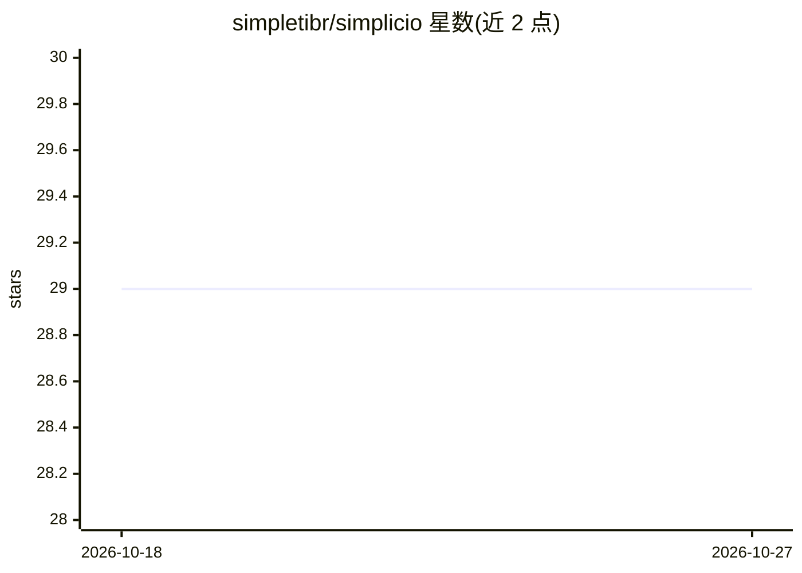

# simpletibr/simplicio

⭐ 29 · Python · 推送 2026-10-26 · [GitHub](https://github.com/simpletibr/simplicio) · [官网](https://simpleti.com.br/simplicio) · 组织维护 · 中文 README

**Rust 单二进制 AI 编程 agent：本地映射/原子编辑/多 agent 编排**

以 100% Rust 编写的单二进制（约 46MB）本地优先 AI 编程 agent 与运行时，提供仓库结构映射（AST/import 拓扑）、有界 token 上下文打包、SHA-256 预映像校验的原子编辑、多阶段并发编排与硬件资源治理等能力。可作为 MCP server 接入 Claude Code、Cursor、VS Code、Zed、JetBrains、Codex 等编辑器，暴露 map/context/edit/loop/parallel 五个工具。通过 install 脚本或 PyPI 引导器安装，映射、编辑与测试门均在本地执行，无静默遥测。软件为 SimpleTI 注册的专有软件。

## 筛选速览

| 维度 | 判定 | 备注 |
|---|---|---|
| AI 角色 | `ai-native` | 本体是模型或模型工具 |
| 许可风险 | `none` | — |
| 部署形态 | `desktop` | 安装包/桌面程序 |
| 模型依赖 | — | README 未给出锁定关系 |
| 硬件要求 | — | 无带数字的原话,不猜 |
| 安装摩擦 | `low` | 无编译、无系统依赖或容器化 |
| 成熟度 | — | 结构信号不足 |

## 能力要点

- 单二进制 Rust 实现，无需 Python/虚拟环境
- AST 图投影替代原始文件树，README 称最多节省 96% token
- 编辑带 SHA-256 预映像校验与不可变审计回执，失败即中止
- 作为 MCP server 集成 Claude Code/Cursor/VS Code/Zed/JetBrains/Codex

## 适用场景

- 让 AI 编程 agent 在 token 预算内定位并修改代码
- 在编辑器中通过 MCP 调用仓库映射与原子编辑工具
- 本地优先地运行多 agent 并发任务且代码不出机器

## 场景标签

`编码 Agent` `多智能体` · 领域:Agent 开发

## 证据(README 行号)

> L6:  Simplicio — AI coding agent
> L43: **Simplicio** is a single-binary, local-first runtime and AI coding agent built in 100% Rust. It replaces heavy con
> L108: Simplicio runs as an official Model Context Protocol (MCP) server for your favorite editors:

## 星数曲线

2026-10-18 29 → 2026-10-27 29（+0）

---
*卡片 v1 · prompt 1.4 · 生成 2026-10-26 · 置信度 high · 依据 README sha `f10bd26c129a` · [字段定义](../../DATASET.md)*
