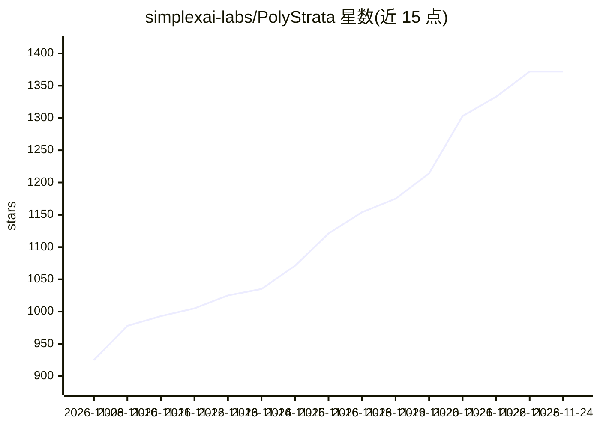

# simplexai-labs/PolyStrata

⭐ 1,372 · C++ · MIT · 推送 2026-11-22 · [GitHub](https://github.com/simplexai-labs/PolyStrata) · 个人维护

**在个人电脑本地运行大模型并提供本地 API 的推理服务器**

PolyStrata 是一个本地 LLM 推理服务器，基于 Strata 引擎与一个为本仓库编写的第二引擎，在 Windows/Linux 个人电脑上运行十四个模型（含 Qwen3.8-Flash-Next、GLM 5.3 Flash、DeepSeek V4 Flash、Qwen3.6、Gemma 4 等），运行期间可在已安装模型间切换，并对外提供本地 API 供应用与编码 agent 调用。README 给出各模型的显存/内存/磁盘要求表、基准测试数据，并提供 --ram-experts-mib 等内存控制参数；GLM 5.3 Flash 与 DeepSeek V4 Flash 仅支持 Linux。

## 筛选速览

| 维度 | 判定 | 备注 |
|---|---|---|
| AI 角色 | `ai-ecosystem` | LLM/agent 周边工具 |
| 许可风险 | `permissive` | MIT |
| 部署形态 | `None` |  |
| 模型依赖 | — | README 未给出锁定关系 |
| 硬件要求 | — | 无带数字的原话,不猜 |
| 安装摩擦 | `medium` | 含编译或系统依赖之一 |
| 成熟度 | — | 结构信号不足 |

## 能力要点

- 两个引擎共运行十四个模型，运行时可切换已安装模型
- 各模型按显卡（8 GB 至 32 GB VRAM）、RAM、磁盘要求逐项列表
- 提供 benchmark 命令在本地测量生成与读入速度
- 专家缓存预算与 --ram-experts-mib / --lock-experts / --vram-reserve-mib 内存控制参数

## 适用场景

- 在自己电脑上本地运行大模型聊天与写代码
- 为本地编码 agent 提供推理后端
- 在 8 GB 显卡笔记本上运行量化模型并测量速度

## 场景标签

`推理引擎` · 领域:训练与推理

## 证据(README 行号)

> L19: PolyStrata runs large AI models on a normal PC, models that usually need a server. They chat, write code and work
> L22: It runs fourteen models, on two engines:
> L62: PolyStrata is built on Strata by Niko1221.

## 星数曲线

2026-11-08 925 → 2026-11-24 1,372（+447）

---
*卡片 v1 · prompt 1.4 · 生成 2026-11-23 · 置信度 high · 依据 README sha `82044e17ae3b` · [字段定义](../../DATASET.md)*
