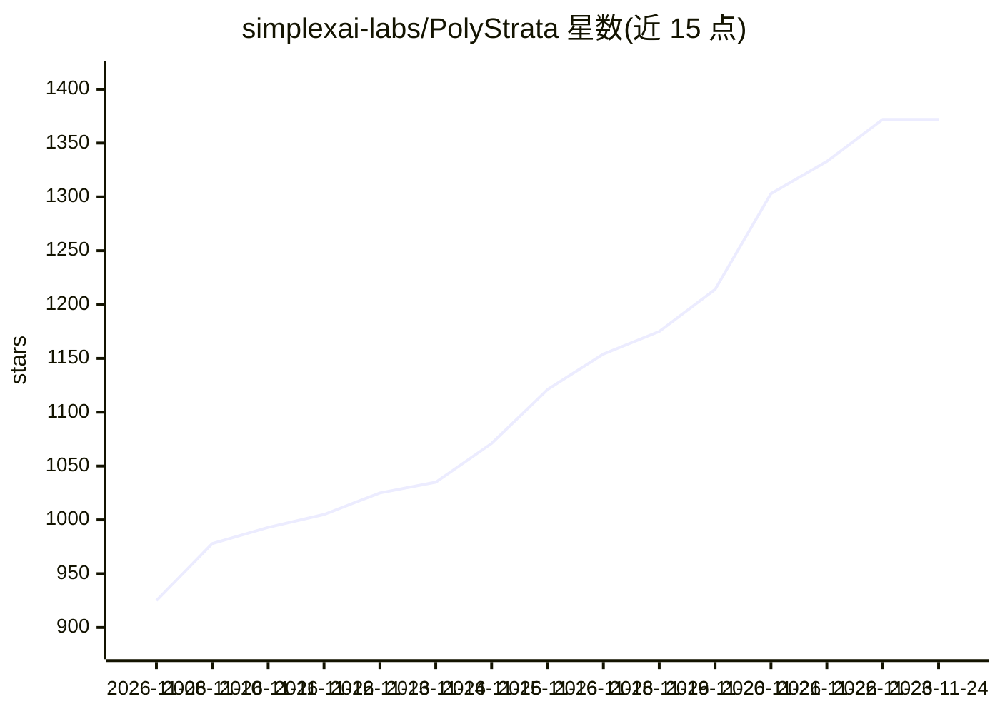

# simplexai-labs/PolyStrata

⭐ 1,448 · C++ · MIT · 推送 2026-11-24 · [GitHub](https://github.com/simplexai-labs/PolyStrata) · 个人维护

**在本地 PC 上一键运行大型开源 LLM 并提供 OpenAI/Anthropic 接口**

PolyStrata 在普通 PC 上本地运行 14 个开源大模型，全部推理不出本机。模型分布在两个引擎上：Qwen3.8-Flash-Next 与 Hy4-Flash 使用 Strata 项目的引擎，其余十三个使用为 PolyStrata 编写的引擎，模型文件多为 GGUF 量化格式，采用 MoE 架构并支持将专家权重放 RAM/SSD 分层加载。服务运行中可切换已安装模型，在 localhost 暴露 OpenAI/Anthropic 格式 API 供应用与编码代理调用。Windows 与 Linux 提供一键安装包，README 给出各模型的显卡/内存/磁盘要求表与每秒 token 基准数据。

## 筛选速览

| 维度 | 判定 | 备注 |
|---|---|---|
| AI 角色 | `ai-ecosystem` | LLM/agent 周边工具 |
| 许可风险 | `permissive` | MIT |
| 部署形态 | `None` |  |
| 模型依赖 | — | README 未给出锁定关系 |
| 硬件要求 | — | 无带数字的原话,不猜 |
| 安装摩擦 | `medium` | 含编译或系统依赖之一 |
| 成熟度 | — | 结构信号不足 |

## 能力要点

- 两个引擎共运行 14 个模型，支持运行中切换
- localhost 提供 OpenAI/Anthropic 格式 API
- 专家权重分层加载：可限制 RAM 占用、从 SSD 读取
- 内置 benchmark 命令可在自己显卡上测速

## 适用场景

- 在没有服务器的家用 PC 或笔记本上跑 35B 级模型聊天写代码
- 给本地编码代理（如 Claude Code）提供本地推理后端
- 在 8 GB 显卡上通过量化与内存分层运行 MoE 模型
- 用自带 benchmark 对比不同显卡上的推理速度

## 场景标签

`推理引擎` · 领域:训练与推理

## 证据(README 行号)

> L18: PolyStrata runs large AI models on a normal PC, models that usually need a server. They chat, write code and work
> L21: It runs fourteen models, on two engines:
> L161: |Qwen3.8-Flash-Next|NVIDIA RTX 20 to 50 series, or AMD RX 6800 / 6900, RX 7700 XT / 7800 XT / 7900 XT / XTX, RX 90

## 星数曲线

2026-11-08 925 → 2026-11-24 1,372（+447）

---
*卡片 v1 · prompt 1.4 · 生成 2026-11-24 · 置信度 high · 依据 README sha `2cc3da551176` · [字段定义](../../DATASET.md)*
