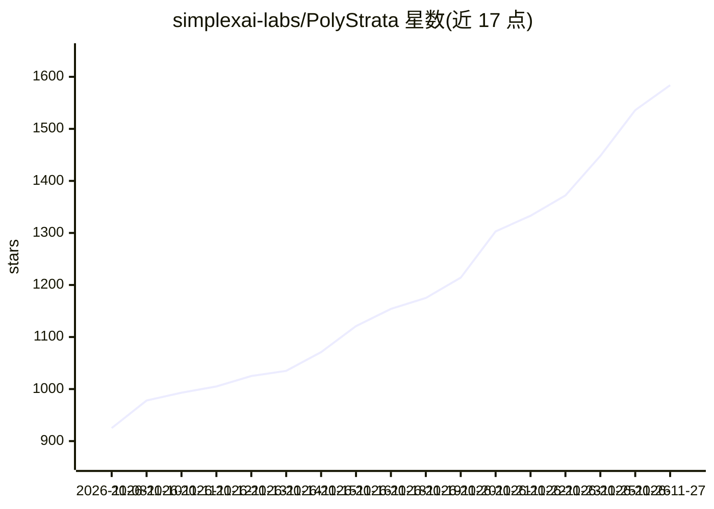

# simplexai-labs/PolyStrata

⭐ 1,584 · C++ · MIT · 推送 2026-11-25 · [GitHub](https://github.com/simplexai-labs/PolyStrata) · 个人维护

**在一台普通 PC 上本地运行大型 AI 模型的推理服务器**

PolyStrata 让用户在自己的 Windows/Linux PC 上运行 14 个大型模型：Qwen3.8-Flash-Next 跑在 Strata 项目的引擎上，其余 13 个跑在为其自研的引擎上（基于 MoE 架构，多数专家权重可留在 RAM/SSD）。提供 Windows 与 Linux 一键安装包，在 localhost 暴露 OpenAI 与 Anthropic 兼容 API，可配合编码 agent 使用；运行中可切换已安装模型，并附带可本地运行的基准测试命令。 README 给出每个模型对显卡、RAM、磁盘与系统的具体要求。

## 筛选速览

| 维度 | 判定 | 备注 |
|---|---|---|
| AI 角色 | `ai-ecosystem` | LLM/agent 周边工具 |
| 许可风险 | `permissive` | MIT |
| 部署形态 | `None` |  |
| 模型依赖 | — | README 未给出锁定关系 |
| 硬件要求 | — | 无带数字的原话,不猜 |
| 安装摩擦 | `medium` | 含编译或系统依赖之一 |
| 成熟度 | — | 结构信号不足 |

## 能力要点

- 14 个模型分跑两个引擎（Strata 引擎 + 自研引擎）
- localhost 提供 OpenAI/Anthropic 兼容 API
- 运行中可在已安装模型间切换
- 附带本地基准测试命令与显存/内存调优参数（--ram-experts-mib、--lock-experts）

## 适用场景

- 在没有服务器的个人电脑上本地运行大型模型聊天与写代码
- 给本地编码 agent 提供 localhost API 后端
- 在 8 GB 显存的笔记本上跑 35B 级 MoE 模型
- 自行测量各模型在自己显卡上的生成速度

## 场景标签

`推理引擎` · 领域:训练与推理

## 证据(README 行号)

> L18: PolyStrata runs large AI models on a normal PC, models that usually need a server. They chat, write code and work
> L21: It runs fourteen models, on two engines:
> L26: The other thirteen run on an engine written for PolyStrata, with one NVIDIA card or two: on Linux, and all but GLM 

## 星数曲线

2026-11-08 925 → 2026-11-27 1,584（+659）

---
*卡片 v1 · prompt 1.4 · 生成 2026-11-26 · 置信度 high · 依据 README sha `82a3645ec3bf` · [字段定义](../../DATASET.md)*
