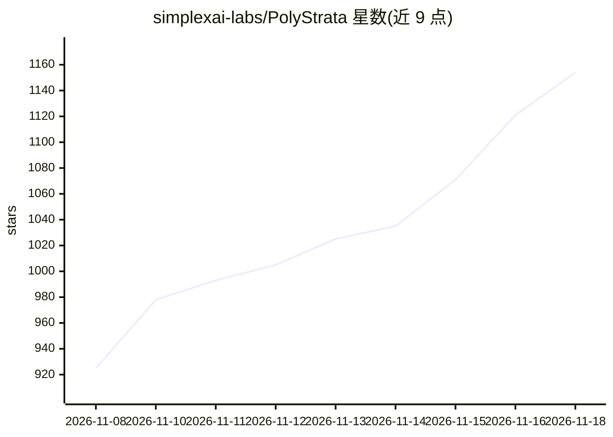

# simplexai-labs/PolyStrata

⭐ 1,154 · C++ · MIT · 推送 2026-11-16 · [GitHub](https://github.com/simplexai-labs/PolyStrata) · 个人维护

**在个人 PC 上本地运行大型 AI 模型的推理引擎**

由 VecSzn 创建、基于 Strata 引擎构建的本地大模型运行时：支持 Qwen3.8-Flash-Next（Strata 原引擎）及 GLM 5.3 Flash、DeepSeek V4 Flash、Qwen3.6、Gemma 4 等 11 个模型（自写引擎，作者标注为实验性）。在 localhost 提供 OpenAI/Anthropic 兼容 API，可配合 Claude Code 等编码代理使用，数据不离开本机。提供 Windows/Linux 一键安装器，支持 NVIDIA/AMD 显卡、多 GPU 与专家缓存 RAM 管理；较大模型需 32 GB 显卡与约 96 GB RAM。README 含与 llama.cpp 的速度对比数据。

## 筛选速览

| 维度 | 判定 | 备注 |
|---|---|---|
| AI 角色 | `ai-ecosystem` | LLM/agent 周边工具 |
| 许可风险 | `permissive` | MIT |
| 部署形态 | `None` |  |
| 模型依赖 | locked-api |  |
| 硬件要求 | — | 无带数字的原话,不猜 |
| 安装摩擦 | `low` | 无编译、无系统依赖或容器化 |
| 成熟度 | `idea` | |

## 能力要点

- 两个引擎运行 12 个模型，localhost 提供 OpenAI/Anthropic API
- 支持 8 GB 显卡笔记本到 32 GB 显卡工作站的分档运行
- 专家缓存 RAM 管理（--ram-experts-mib / --lock-experts）
- Windows/Linux 一键安装器，自带 benchmark 命令

## 适用场景

- 在个人电脑上本地运行大型模型进行对话与代码编写
- 为 Claude Code 等编码代理提供本地 API 后端
- 在低显存机器上通过 RAM/SSD 卸载运行 MoE 模型

## 场景标签

`推理引擎` · 领域:训练与推理

## 证据(README 行号)

> L19: PolyStrata runs large AI models on a normal PC, models that usually need a server. They chat, write code and work
> L27: The other eleven run on an engine written for PolyStrata, with one NVIDIA card or two: on Linux, and all but GLM 5.
> L54: PolyStrata was created by VecSzn.

## 星数曲线

2026-11-08 925 → 2026-11-18 1,154（+229）

---
*卡片 v1 · prompt 1.4 · 生成 2026-11-17 · 置信度 high · 依据 README sha `3f293cddedd7` · [字段定义](../../DATASET.md)*
