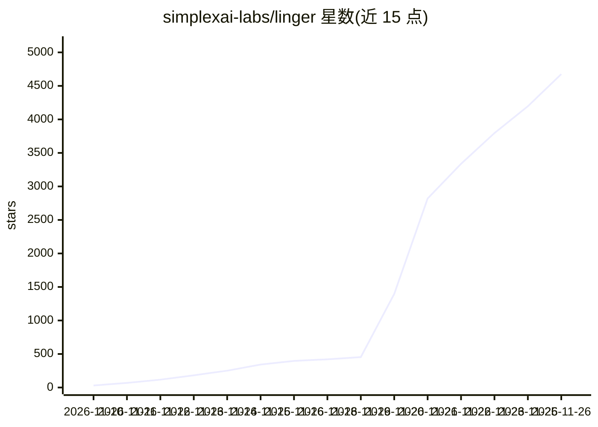

# simplexai-labs/linger

⭐ 4,675 · TypeScript · NOASSERTION · 推送 2026-11-25 · [GitHub](https://github.com/simplexai-labs/linger) · [官网](heylinger.com) · 组织维护

**本地运行的开源个人 agent：邮件/日历/聊天成共享记忆**

面向个人用户的本地 AI agent 应用，在消费级 Mac 和 PC 上运行本地模型（借助自研 MoE 推理引擎 PolyStrata，将高频专家放 GPU、其余放 RAM/SSD）。功能包括：自动检测硬件并推荐安装模型的 Model Autopilot、夜间将 Gmail/Outlook/Slack/会议整理为个人 wiki 的共享记忆、主动提醒的 Another Me（通过夜间重写决策规则实现自我改进）、agent 团队协作与后台任务委派。桌面应用支持 macOS/Windows/Linux，或以 Docker Compose 部署服务器。

## 筛选速览

| 维度 | 判定 | 备注 |
|---|---|---|
| AI 角色 | `ai-native` | 本体是模型或模型工具 |
| 许可风险 | `none` | NOASSERTION |
| 部署形态 | `desktop` | 安装包/桌面程序 |
| 模型依赖 | — | README 未给出锁定关系 |
| 硬件要求 | — | 无带数字的原话,不猜 |
| 安装摩擦 | `low` | 无编译、无系统依赖或容器化 |
| 成熟度 | — | 结构信号不足 |

## 能力要点

- PolyStrata 引擎：125B MoE 模型在 12 GB GPU + 64 GB RAM 上运行
- Model Autopilot 一条命令检测硬件、推荐并安装模型（64K+ 上下文）
- 夜间将邮件、聊天、会议整理为所有 agent 可搜索的个人 wiki 图谱
- Another Me 主动跟进并通过每夜规则重写学习用户偏好

## 适用场景

- 让 agent 读写我的邮箱、日历和 Slack 并主动提醒待办
- 在无云服务费的本地环境运行带记忆的个人助理
- 一台模型同时驱动多个 agent 协作与后台长任务

## 场景标签

`AI 助手` `Agent 记忆` · 领域:Agent 开发

## 证据(README 行号)

> L3:  Linger is an open-source personal agent with a Claude-class brain running locally on your PC.
> L18: - **A Claude-class brain, running locally.** A 125B model on a 12 GB GPU, on everyday Macs and PCs.

## 星数曲线

2026-11-10 30 → 2026-11-26 4,675（+4,645）

---
*卡片 v1 · prompt 1.4 · 生成 2026-11-26 · 置信度 high · 依据 README sha `fd2808e6e636` · [字段定义](../../DATASET.md)*
