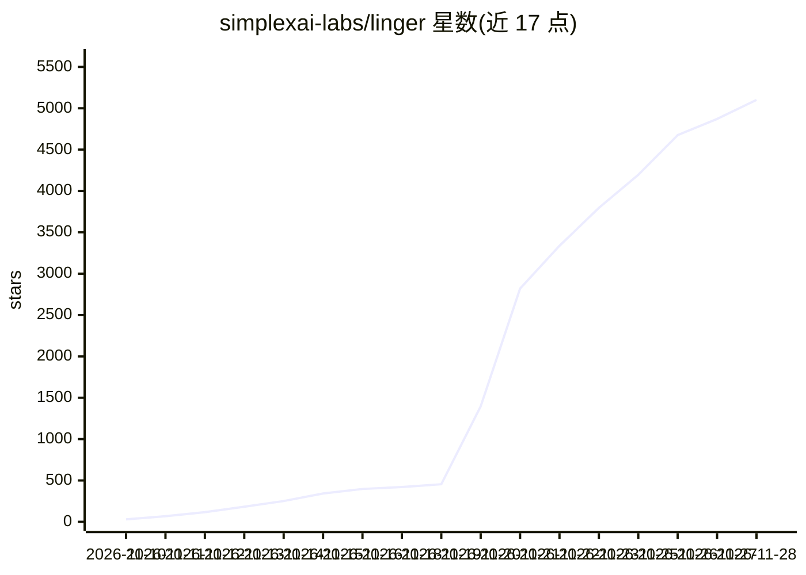

# simplexai-labs/linger

⭐ 5,101 · TypeScript · NOASSERTION · 推送 2026-11-27 · [GitHub](https://github.com/simplexai-labs/linger) · [官网](heylinger.com) · 组织维护

**在消费级 PC 本地运行的开源个人 Agent**

Linger 是一个在用户自己的 Mac/PC 上本地运行的个人 Agent：内置 MoE 推理引擎 PolyStrata，通过将高频专家放在 GPU、其余放在 RAM/SSD 的方式，使 125B 模型可在 12 GB 显存显卡上运行；提供 Model Autopilot 检测硬件并自动推荐安装模型、跨 Agent 共享的个人 Wiki 记忆（夜间从邮件/聊天/会议整理为图谱页面）、主动型 Another Me（基于规则改写的夜间自学习），以及 Agent 团队、后台任务委派、桌面/浏览器操作和语音转写。桌面应用处于 Beta，另支持 Docker Compose 部署；无 Intel Mac 安装包。

## 筛选速览

| 维度 | 判定 | 备注 |
|---|---|---|
| AI 角色 | `ai-native` | 本体是模型或模型工具 |
| 许可风险 | `none` | NOASSERTION |
| 部署形态 | `desktop` | 安装包/桌面程序 |
| 模型依赖 | — | README 未给出锁定关系 |
| 硬件要求 | — | 无带数字的原话,不猜 |
| 安装摩擦 | `low` | 无编译、无系统依赖或容器化 |
| 成熟度 | `idea` | |

## 能力要点

- PolyStrata 引擎：125B 模型以 2-bit 量化运行在 12 GB GPU（需 64 GB RAM）
- Model Autopilot：检测硬件并自动推荐、安装、验证模型
- 夜间整理邮件/聊天/会议为个人 Wiki 图谱，所有 Agent 共享检索
- Another Me 主动跟进事务，每晚依据用户反馈重写决策规则

## 适用场景

- 在本地电脑上运行个人 AI 助手而不产生云端 token 费用
- 让 Agent 自动跟进邮件、日历与 Slack 中的重要事项
- 跨设备共享一台服务器为多个电脑提供 Agent 服务

## 场景标签

`AI 助手` `推理引擎` · 领域:对话与助手

## 证据(README 行号)

> L3:  Linger is an open-source personal agent with a Claude-class brain running locally on your PC.
> L18: - **A Claude-class brain, running locally.** A 125B model on a 12 GB GPU, on everyday Macs and PCs.

## 星数曲线

2026-11-10 30 → 2026-11-28 5,101（+5,071）

---
*卡片 v1 · prompt 1.4 · 生成 2026-11-28 · 置信度 high · 依据 README sha `41fbe7e7ad12` · [字段定义](../../DATASET.md)*
