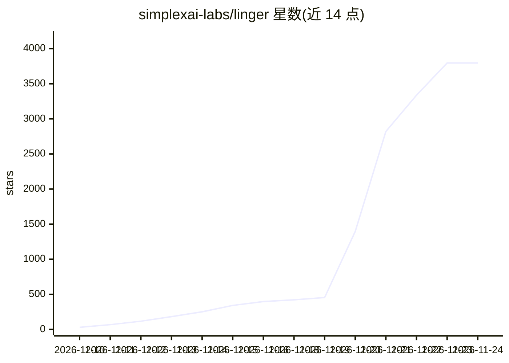

# simplexai-labs/linger

⭐ 3,796 · TypeScript · NOASSERTION · 推送 2026-11-22 · [GitHub](https://github.com/simplexai-labs/linger) · [官网](heylinger.com) · 组织维护

**在消费级电脑上完整本地运行的个人 AI 代理**

Linger 是一个开源个人代理，在本地 PC/Mac 上运行本地模型：内置自研 MoE 推理引擎 PolyStrata，将高频专家保留在 GPU、其余放入 RAM/SSD，使 125B 模型在 12 GB GPU 上运行；安装时按硬件检测推荐并安装模型。代理侧提供共享 wiki 记忆（夜间从 Gmail/Slack/日历等来源更新为图结构页面）、主动触达的 Another Me 代理（夜间重写决策规则）、agent 团队、后台任务委派、模型调度、桌面/浏览器操作与语音转写。提供 macOS/Windows 安装包与 Docker、源码方式。

## 筛选速览

| 维度 | 判定 | 备注 |
|---|---|---|
| AI 角色 | `ai-native` | 本体是模型或模型工具 |
| 许可风险 | `none` | NOASSERTION |
| 部署形态 | `desktop` | 安装包/桌面程序 |
| 模型依赖 | — | README 未给出锁定关系 |
| 硬件要求 | — | 无带数字的原话,不猜 |
| 安装摩擦 | `low` | 无编译、无系统依赖或容器化 |
| 成熟度 | — | 结构信号不足 |

## 能力要点

- PolyStrata 引擎：125B MoE 模型在 12 GB GPU + 64 GB RAM 上运行（45.5 tok/s @ RTX 3060）
- Model Autopilot：一条命令检测硬件并推荐、安装、验证模型
- 夜间将邮件/聊天/会议归档为个人 wiki，全代理共享检索
- Another Me 代理主动触达并通过夜间 Dreaming 重写决策规则

## 适用场景

- 在无云账单、无 token 费用的前提下本地运行个人 AI 助手
- 让代理记住邮件、聊天和会议中的重要信息并在代理间共享
- 让代理监控收件箱/日历/Slack 并在需要时主动提醒
- 一条命令为自己的硬件自动挑选并安装合适的本地模型

## 场景标签

`AI 助手` `推理引擎` `Agent 记忆` · 领域:Agent 开发

## 证据(README 行号)

> L3:  Linger is an open-source personal agent with a Claude-class brain running locally on your PC.
> L16:  Linger in 28.5 seconds: a metal laptop opens, sets up a local model and connects apps. Mail, chats and meetings be
> L20: - **A loyal AI sidekick.** It remembers what matters, proactively gets things done, and keeps your data on your dev

## 星数曲线

2026-11-10 30 → 2026-11-24 3,796（+3,766）

---
*卡片 v1 · prompt 1.4 · 生成 2026-11-23 · 置信度 high · 依据 README sha `0837d3b43d88` · [字段定义](../../DATASET.md)*
