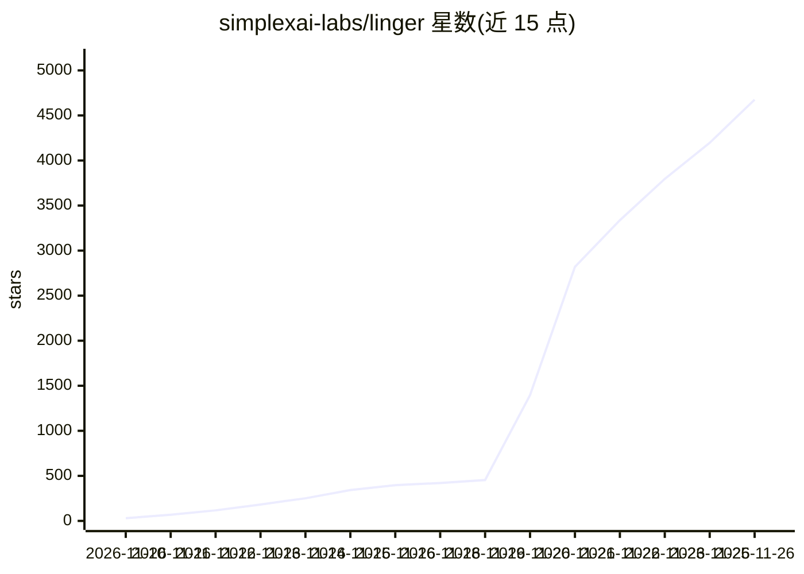

# simplexai-labs/linger

⭐ 4,675 · TypeScript · NOASSERTION · 推送 2026-11-25 · [GitHub](https://github.com/simplexai-labs/linger) · [官网](heylinger.com) · 组织维护

**在消费级电脑上本地运行的个人 AI 代理**

开源个人代理，本体由本地 MoE 推理引擎 PolyStrata 驱动：将最常被选中的专家放在 GPU、其余放在 RAM/SSD，使 125B 模型可在 12 GB 显存加 64 GB RAM 的机器上运行。功能包括安装时检测硬件并推荐安装模型（Model Autopilot）、每晚把邮件/聊天/会议写入本地 wiki 的共享记忆、主动发消息的 Another Me 代理（按用户反馈夜间重写决策规则）、agent 团队、后台任务委派、模型调度与会议转写。提供 macOS/Windows/Linux 桌面安装包，Intel Mac 走 Docker Compose。

## 筛选速览

| 维度 | 判定 | 备注 |
|---|---|---|
| AI 角色 | `ai-native` | 本体是模型或模型工具 |
| 许可风险 | `none` | NOASSERTION |
| 部署形态 | `desktop` | 安装包/桌面程序 |
| 模型依赖 | — | README 未给出锁定关系 |
| 硬件要求 | — | 无带数字的原话,不猜 |
| 安装摩擦 | `low` | 无编译、无系统依赖或容器化 |
| 成熟度 | — | 结构信号不足 |

## 能力要点

- PolyStrata 推理引擎：125B MoE 模型在 12 GB GPU + 64 GB RAM 上运行（45.5 tok/s @RTX 3060）
- Model Autopilot：检测 GPU/内存/带宽后自动推荐、安装并验证模型
- 每晚将邮件、Slack、会议归档为可供所有代理检索的本地 wiki
- Another Me 代理主动跟进事件，并按用户反应夜间重写规则

## 适用场景

- 在个人电脑上本地运行代理助手而不依赖云端 API
- 让代理记住邮件/聊天/会议中的信息并跨会话检索
- 让代理主动跟进收件箱与日程并在需要时通知我
- 多个代理按同一份 team.md 协作完成一项任务

## 场景标签

`推理引擎` `AI 助手` · 领域:对话与助手

## 证据(README 行号)

> L3:  Linger is an open-source personal agent with a Claude-class brain running locally on your PC.
> L28: Efficient AI model–harness co-design brings a full local agent to consumer Macs and PCs. Our MoE inference engine, 
> L51: One command detects your hardware, recommends the best model, installs it and checks it. In our lab we run an archi

## 星数曲线

2026-11-10 30 → 2026-11-26 4,675（+4,645）

---
*卡片 v1 · prompt 1.4 · 生成 2026-11-24 · 置信度 high · 依据 README sha `eca1f7133980` · [字段定义](../../DATASET.md)*
