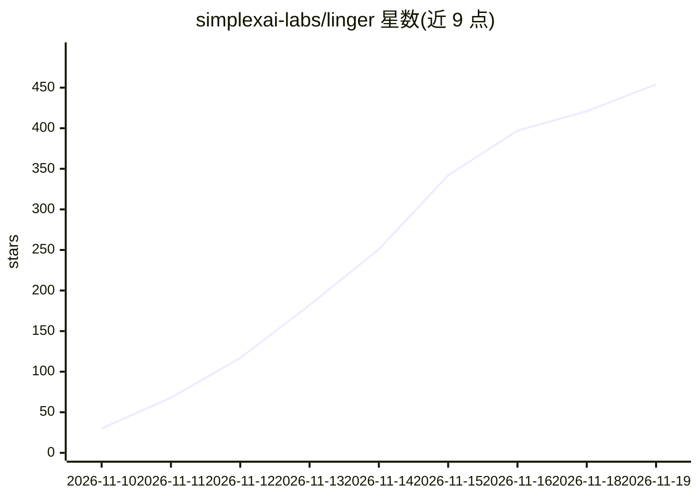

# simplexai-labs/linger

⭐ 454 · TypeScript · NOASSERTION · 推送 2026-11-18 · [GitHub](https://github.com/simplexai-labs/linger) · [官网](heylinger.com) · 组织维护

**在个人电脑上本地运行的开源个人 agent，含记忆与主动提醒**

面向个人消费者的本地 AI agent 应用：通过自研 MoE 推理引擎 PolyStrata 将 125B 量化模型放进 12 GB GPU + 64 GB RAM 的消费级 Mac/PC 上运行，无云端 token 费用。功能包括 Model Autopilot（检测硬件并推荐/安装模型）、夜间把邮件/日历/Slack 汇入个人 wiki 的共享记忆、监听收件箱并主动提醒的 Another Me（夜间重写决策规则）、agent 团队与任务委派、桌面/浏览器操作、语音转录，以及自带 Claude Code/Codex/Pi 运行时。提供 macOS/Windows/Linux 桌面安装包，Intel Mac 需用 Docker Compose。

## 筛选速览

| 维度 | 判定 | 备注 |
|---|---|---|
| AI 角色 | `ai-native` | 本体是模型或模型工具 |
| 许可风险 | `none` | NOASSERTION |
| 部署形态 | `desktop` | 安装包/桌面程序 |
| 模型依赖 | — | README 未给出锁定关系 |
| 硬件要求 | — | 无带数字的原话,不猜 |
| 安装摩擦 | `low` | 无编译、无系统依赖或容器化 |
| 成熟度 | — | 结构信号不足 |

## 能力要点

- PolyStrata MoE 引擎：热门专家驻留 GPU，其余置于 RAM/SSD，125B 模型跑在 12 GB GPU
- Model Autopilot 检测 GPU/内存/带宽并自动推荐安装可用模型
- 夜间将 Gmail/Outlook/Slack/日历/会议整理为实体图谱 wiki，LoCoMo 记忆基准 95%
- Another Me 主动提醒并在每晚根据反馈重写决策规则，无需重训模型

## 适用场景

- 在本地电脑上运行个人 AI 助手处理邮件、日程与聊天并保留数据在设备上
- 让 agent 团队自动操作桌面应用与浏览器并代发邮件（发送前需批准）
- 让助手在合适时机主动提醒待办与跟进事项

## 场景标签

`AI 助手` `GUI 自动化` · 领域:效率与自动化

## 证据(README 行号)

> L3:  Linger is an open-source personal agent with a Claude-class brain running locally on your PC.
> L17: - **A Claude-class brain, running locally.** A 125B model on a 12 GB GPU, on everyday Macs and PCs.
> L74: Tell one agent, and every agent knows. Another Me reads back through your inbox, then each night files your mail, c

## 星数曲线

2026-11-10 30 → 2026-11-19 454（+424）

---
*卡片 v1 · prompt 1.4 · 生成 2026-11-17 · 置信度 high · 依据 README sha `12310ef9144b` · [字段定义](../../DATASET.md)*
