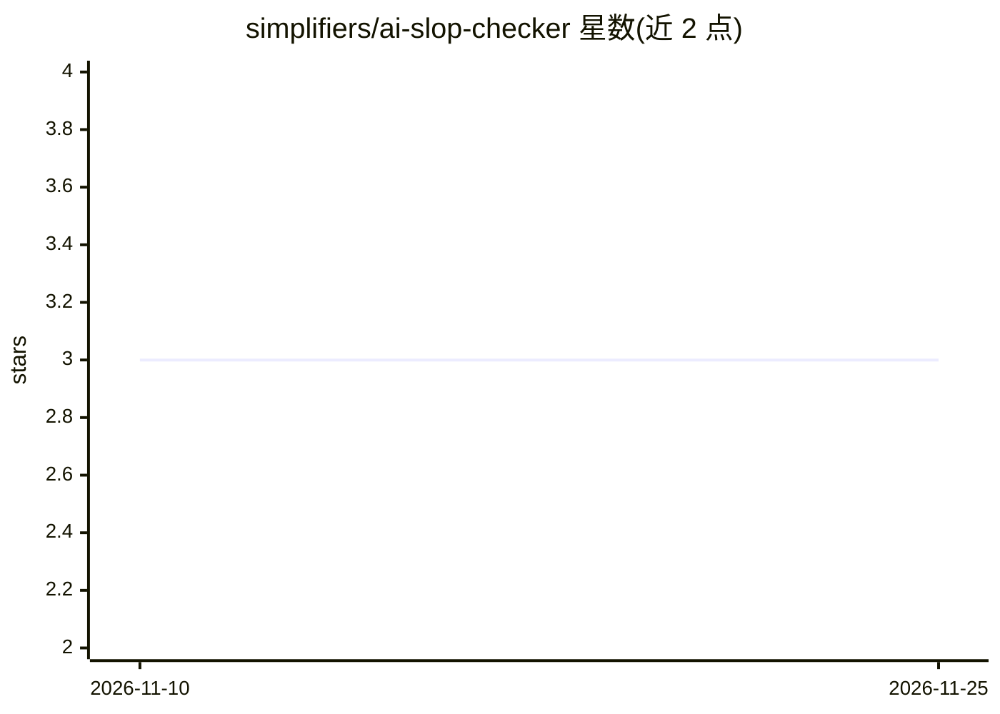

# simplifiers/ai-slop-checker

⭐ 3 · Python · MIT · 推送 2026-10-30 · [GitHub](https://github.com/simplifiers/ai-slop-checker) · [官网](https://app.redaktion.ai/ai-slop-checker?lang=en&ref=github) · 组织维护

**检查 AI 辅助写作的德英双语 linter：找无出处数字、空泛说法与机器节奏**

纯 Python、无依赖、离线运行的命令行检查器（slop-check），针对用语言模型辅助撰写的文章与通讯。检查优先级为实质内容缺失（无来源数字、无名引用的断言）、套话、结构性模板与基于人类文本基线的节奏指标（如每句词数、MATTR 词汇多样性）。输出 pass/revise/too_short 判定与逐条建议，支持与原始笔记比对事实缺漏，输出 HTML/JSON 报告，可经 --fail-on 集成 CI。通过 pip/pipx 安装，或作为 Claude skill 使用。短于 120 词不给出总体判定。

## 筛选速览

| 维度 | 判定 | 备注 |
|---|---|---|
| AI 角色 | `ai-enhanced` | 去掉 AI 部分产品仍成立 |
| 许可风险 | `permissive` | MIT |
| 部署形态 | `desktop` | 安装包/桌面程序 |
| 模型依赖 | — | README 未给出锁定关系 |
| 硬件要求 | — | 无带数字的原话,不猜 |
| 安装摩擦 | `low` | 无编译、无系统依赖或容器化 |
| 成熟度 | — | 结构信号不足 |

## 能力要点

- 六类检查：实质、事实、套话、结构、节奏、排版，三级严重度（fail/tell/hint）
- 九项节奏指标对照 2022 年前 Wikinews 人类文本基线（德 157 篇/英 162 篇）
- --source 与原始笔记/采访转录比对，列出缺失事实与多余数字
- 支持 JSON/HTML 输出、GitHub Action、可配置白名单与禁用词

## 适用场景

- 发布前检查 AI 辅助撰写的博客或通讯是否有无出处断言
- 在 CI 中对 PR 里的 Markdown 做质量门禁
- 核对成稿是否遗漏了采访笔记中的事实

## 场景标签

`AI 写作` · 领域:内容生成

## 证据(README 行号)

> L3: **AI slop checker for German and English.** It checks articles and newsletters written with help from a language mod
> L11: Most tools against "AI slop" hunt for a list of words and the long dash. Delete them all and the text can still say
> L131: - It is not an AI detector. A finding says a passage is generic or unsupported. It says nothing about who or what 

## 星数曲线

2026-11-10 3 → 2026-11-25 3（+0）

---
*卡片 v1 · prompt 1.4 · 生成 2026-11-21 · 置信度 high · 依据 README sha `1efefe28b596` · [字段定义](../../DATASET.md)*
